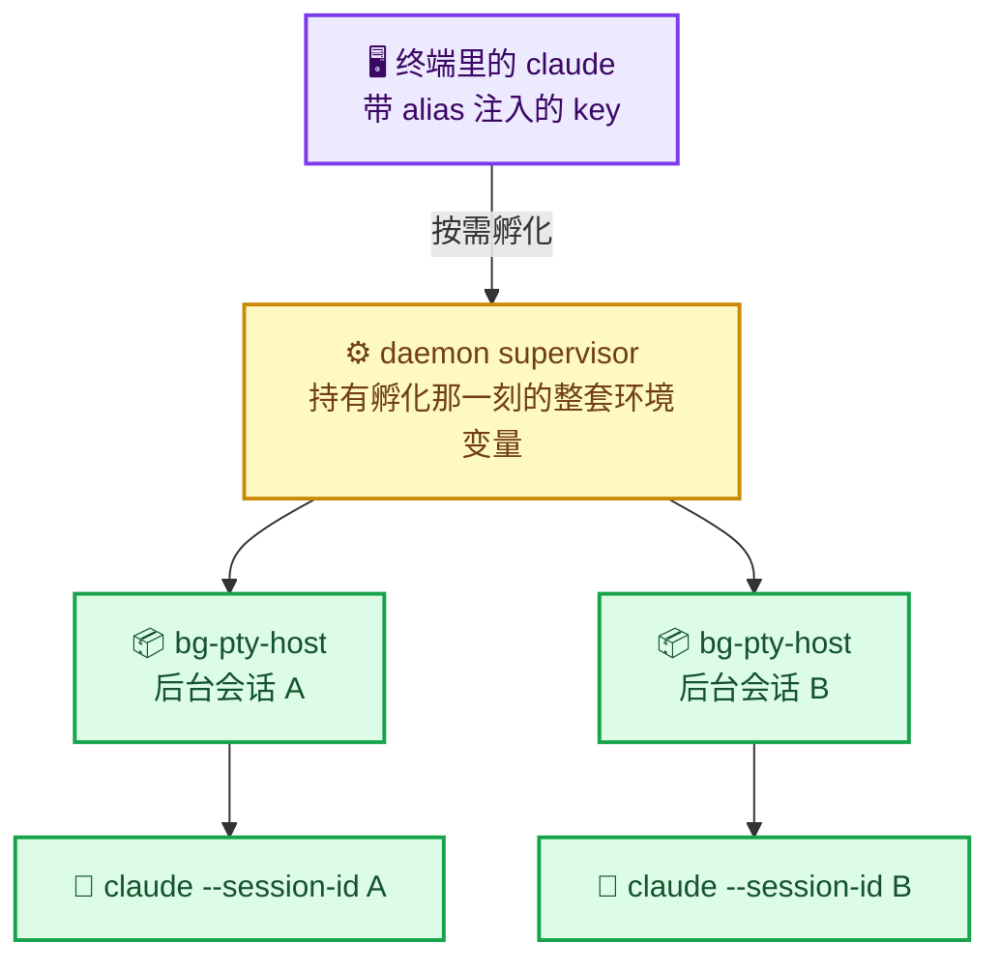
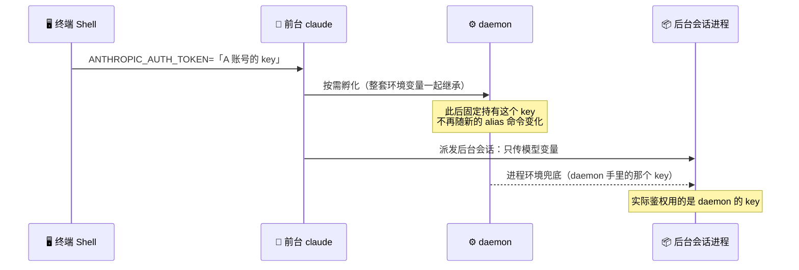
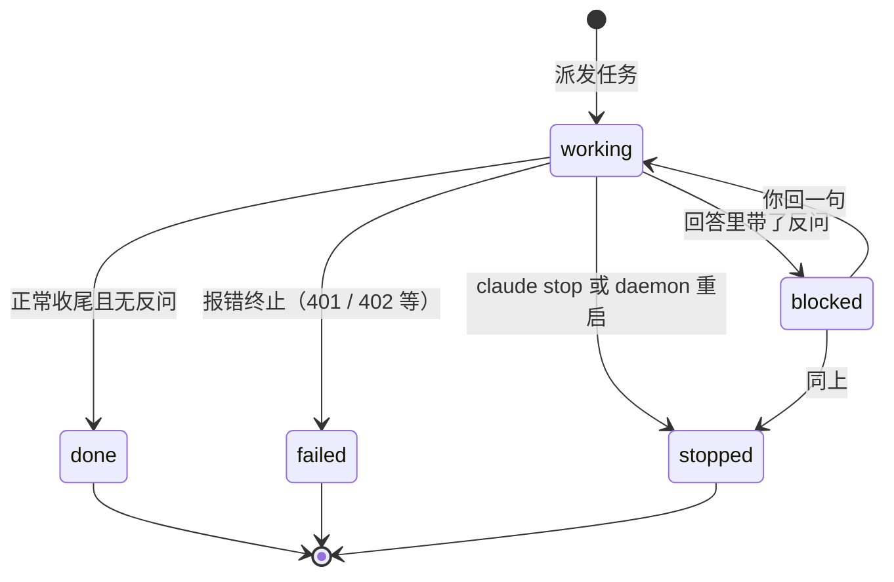

# Claude Code 后台会话与密钥串号：daemon 机制、排查与规避

_多套 API 凭据并行时的环境变量继承陷阱 · 难度：中等 · 最后验证：2026-10-09_

---

## 📋 概述

### 现象

同时配置了多套 API 凭据（比如 A 账号一套、B 账号一套），用 alias 区分启动方式。结果出现两类怪事：

- 用 `claude-a` 启动的会话，账单却记到了 **另一个 key** 上
- 用 `/resume` 续上一个老会话，鉴权立刻变成另一个 key 的账号，报 `401 Authentication Fails` 或 `402 Insufficient Balance`

排查下来，问题不在 alias，也不在 profile 配置文件，而在 **Claude Code 自带的 daemon 进程**：后台会话由 daemon 托管，而 daemon 持有**自己启动那一刻**继承到的环境变量，alias 注入的 key 根本传不进去。

### 你会学到什么

- daemon 是什么、什么时候会被拉起来、它托管哪些会话
- 密钥为什么会「串号」——完整的继承链路，以及它为什么会跨 daemon 换代传播
- 一条命令核对 daemon 及其 worker 实际在用哪个 key
- `claude agents` 里 `Needs input` / `Done` / `Stopped` / `Failed` 到底是什么意思
- 如何规避，以及一串清理动作的取舍

### 排查总览

```mermaid
flowchart LR
    accTitle: Token Routing Triage Steps
    accDescr: 发现账单归属异常或鉴权报错时，从确认会话宿主、核对 daemon 持有的 key，到停掉并重启 daemon 的五步排查顺序

    symptom["🔍 账单记到别的 key<br/>或出现 401 / 402"] --> step1["1 看会话是前台还是后台<br/>claude agents --json"]
    step1 --> step2["2 核对 daemon 持有的 key<br/>cc-daemon-auth"]
    step2 --> step3["3 停掉被污染的 daemon<br/>claude daemon stop --any"]
    step3 --> step4["4 用正确 key 的终端起新会话<br/>让新 daemon 从它继承环境"]
    step4 --> step5["5 再核对一次<br/>cc-daemon-auth"]

    classDef start fill:#ede9fe,stroke:#7c3aed,stroke-width:2px,color:#3b0764
    classDef stage fill:#dbeafe,stroke:#2563eb,stroke-width:2px,color:#1e3a5f
    classDef final fill:#dcfce7,stroke:#16a34a,stroke-width:2px,color:#14532d

    class symptom start
    class step1,step2,step3,step4 stage
    class step5 final
```



---

## 🧭 daemon 是什么

**它是 `claude` CLI 自带的子命令，不是插件、不是 hook、也不是系统服务。**

```bash
claude daemon --help
```

```text
Usage: claude daemon [subcommand] [options]

Service lifecycle:
  run [json-path]   Run the supervisor in the foreground (default when piped)
  status            Show daemon pid, version, uptime
  logs              Tail the daemon log (Ctrl-C to stop)
  uninstall         Remove the background service (launchctl/systemd)
  stop              Shut down the supervisor and terminate background sessions
                      --any           also stop a transient (non-service) daemon
                      --keep-workers  leave detached sessions running

  Service install is disabled in this version — the daemon runs on demand
  and exits when the last client disconnects.
```

### 它的职责

托管**后台会话**——脱离当前终端继续跑的 Claude Code 会话。触发来源包括 `--bg` / `Ctrl+B` 转后台、teammate 子代理、worktree 后台任务。

- **按需启动**：由某个 `claude` 进程在需要时孵化，`origin` 标记为 `transient`
- **最后一个客户端断开即退出**：没有常驻的 launchctl / systemd 服务（至少 2.1.294 如此）
- **谁在 hold 它**：`claude daemon status` 会列出来——运行中的后台 worker、以及任何开着的 `claude agents` 客户端

### 进程与文件



> ⚠️ **黄色那一层是问题所在。** 它是整条继承链的源头，而不是每个会话各自持有的配置。

相关文件都在 `~/.claude/` 下：

| 路径 | 内容 |
|------|------|
| `daemon.lock` | 当前 daemon 的 pid、版本、启动时间、由谁孵化（`spawnedBy`） |
| `daemon.status.json` | supervisor pid 与 worker 概览 |
| `daemon.log` | supervisor 日志：启动、worker 派发、会话结算 |
| `daemon/roster.json` | 每个 worker 的 pid、会话 id、dispatch 参数与环境变量 |
| `jobs/<id>/state.json` | 单个后台会话的状态、token 用量、待答问题、重放参数 |

---

## 🔐 密钥继承链

### 为什么不生效

alias 做的事是「给这一次命令临时注入环境变量」：

```bash
alias claude-a='ANTHROPIC_AUTH_TOKEN="$PROVIDER_A_KEY" claude --settings ~/.claude/profiles/provider-a.json'
```

这个变量**只存在于那个前台进程**里。会话一旦转成后台、被 daemon 托管，实际发起请求的是 daemon 孵化出来的 worker 进程，而它继承的是 **daemon 的环境**。

而且传不进去是有据可查的：`roster.json` 里每个 worker 的 `dispatch.env` 只带模型相关变量（`ANTHROPIC_MODEL`、各档位默认模型、子代理模型），**不带任何 token**。同时 profile 文件里也没有 token 字段（key 按约定只走环境变量），所以覆盖不了。



### 为什么会跨代传播

daemon 只在**启动那一刻**继承一次环境，之后永久复用。而 daemon 换代时，新 daemon 往往由旧 daemon 的某个 worker 进程孵化——于是那个 key 又传给下一代。

结果就是：**哪怕你这次明明用的是 `claude-a`，只要 daemon 里存的是另一个 key，后台会话就全用那个 key**。没有报错，只有账单慢慢错位。等哪天把那个 key 停掉，所有后台会话会一起变成 `401`。

> 📌 **判别要诀**：异常只出现在**后台会话**（`kind: background`），前台的 `kind: interactive` 会话一切正常——基本可以断定是这条继承链，而不是 alias 或 profile 写错了。

---

## 🩺 排查：一条命令核对归属

下面的函数放进 `~/.zshrc.d/` 里任何一个会被 source 的片段即可。它拿 pid 的环境变量去和已知的 key 变量做**相等比较**，只报「匹配到哪个变量名」，**不打印 key 本身**。

```bash
# 打印 daemon 及其 worker 实际使用的 ANTHROPIC_AUTH_TOKEN 来自哪个环境变量
_cc_auth_label() {
  local t="$1" v
  local -a vars=(PROVIDER_A_KEY PROVIDER_B_KEY PROVIDER_C_KEY)
  if [ -z "$t" ]; then echo "NO-TOKEN"; return; fi
  for v in "${vars[@]}"; do
    if [ -n "${(P)v}" ] && [ "$t" = "${(P)v}" ]; then
      echo "$v"
      return
    fi
  done
  echo "OTHER(未匹配已知变量)"
}

cc-daemon-auth() {
  local lock="$HOME/.claude/daemon.lock" pid tok child

  [ -r "$lock" ] || { echo "读不到 $lock" >&2; return 1 }

  pid="$(python3 -I -c 'import json,sys;print(json.load(open(sys.argv[1])).get("pid",""))' "$lock" 2>/dev/null)"
  if [ -z "$pid" ] || ! kill -0 "$pid" 2>/dev/null; then
    echo "daemon 未在运行（lock 中 pid=${pid:-?}）"
    return 0
  fi

  tok="$(ps eww "$pid" 2>/dev/null | tr ' ' '\n' | sed -n 's/^ANTHROPIC_AUTH_TOKEN=//p' | head -1)"
  echo "daemon  pid=$pid  token=$(_cc_auth_label "$tok")"

  for child in $(pgrep -P "$pid" 2>/dev/null); do
    tok="$(ps eww "$child" 2>/dev/null | tr ' ' '\n' | sed -n 's/^ANTHROPIC_AUTH_TOKEN=//p' | head -1)"
    printf '  worker pid=%s  token=%s\n' "$child" "$(_cc_auth_label "$tok")"
  done

  echo "本 shell  token=$(_cc_auth_label "$ANTHROPIC_AUTH_TOKEN")"
}
```

**预期输出：**

```text
daemon  pid=36636  token=PROVIDER_A_KEY
  worker pid=36669  token=PROVIDER_A_KEY
  worker pid=36942  token=PROVIDER_A_KEY
本 shell  token=NO-TOKEN
```

怎么读：

- **`daemon` 那一行说了算。** 它是哪个变量，下面所有后台会话就是哪个 key。
- 出现 `PROVIDER_B_KEY` 之类的非预期值，说明 daemon 被污染了。
- 出现 `NO-TOKEN` 说明 daemon 环境里没有这个变量，worker 会退回其他鉴权来源。
- `本 shell` 一行在普通终端里通常是 `NO-TOKEN`——alias 的注入是临时的，不驻留。

> ⚠️ **不要直接把 token 打进终端或贴进 issue。** `ps eww` 的输出包含完整 key，上面的写法是把它喂给比较函数、只输出标签，复制排查结论时请保持这种方式。

---

## 🗂️ 后台会话的状态怎么读

三条途径，粒度不同。

| 途径 | 用途 |
|------|------|
| `claude agents` | 交互式列表，看每个会话一行状态文案 |
| `claude agents --json` | 机器可读，最准：`kind` / `status` / `state` / `pid` |
| `~/.claude/jobs/<id>/state.json` | 单会话细节：待答问题、最终结果、重放参数 |

### 状态文案的含义

| 状态位 | 含义 | 算不算完结 |
|--------|------|-----------|
| `Done` | 任务正常收尾 | 是 |
| `Failed` | 报错终止 | 是，但没干成 |
| `Stopped` | 被 `claude stop` / `claude rm` / daemon 重启带走 | 是，被外力掐断 |
| `Needs input` | 这一轮跑完了，**卡在等你回话** | 不是，还活着，能继续 |
| 无状态位 / 转圈 | 正在执行 | 否 |

列表左边的符号：`*` = 需要你关注（就是 `Needs input` 那些），`·` = 不用管。

### Needs input 的真实判据

`Needs input` **不代表还有任务在跑，也不代表你退出得不干净**。它的判据是：会话最后一轮里，**模型的回答包含了一个反问**。

这一点在 `jobs/<id>/state.json` 里是显式字段：

| 字段 | 含义 |
|------|------|
| `state` | `working` / `blocked` / `done` / `stopped` / `failed` |
| `tempo` | `active` / `idle` / `blocked` |
| `needs` | 模型抛给你的待答问题原文。**非空 → `blocked` → 列表显示 `Needs input`** |
| `suggestedReply` | 模型建议的快捷回复 |
| `output.result` | 本轮最终产出（正常收尾时才有） |
| `inFlight.tasks` | 正在跑的子任务数。`0` 表示没有任何任务在跑 |
| `backend` | `daemon` 表示这个会话是 daemon 托管的 |

对照一组实际数据：

| 会话 | `state` | `needs` |
|------|---------|---------|
| 会话 A | `done` | 空 |
| 会话 B | `done` | 空 |
| 会话 C | `blocked` | `需要我修复这些问题吗？` |
| 会话 D | `blocked` | `要我把这份清单整理进技术方案，还是先等审代码？` |

`needs` 空 → `done`；`needs` 有内容 → 一直 `blocked`，挂多久都不会自己变。有会话在 `blocked` 上躺了一个多月，就是因为当时没人回那句话。



### 退出方式不影响状态

`/exit` 和从 agents 页面 `Ctrl+C` 退出，都只是**断开你的终端附着**。后台会话活在 daemon 里，关终端它照样跑。状态在**最后一轮答复结束的那一刻**就定死了，之后怎么退都改不了它。

这也是「明明执行完了，却一直是 Needs input」的唯一原因：模型最后那句是「需要我继续吗？」。

---

## 🕳️ 踩坑记录

### 坑 1：用 alias 换了 key，账单却记到另一个 key

**症状**

用 `claude-a`（A 账号的 key）启动会话，账单出现在 B 账号的 key 下。没有报错，只有账目对不上。

**原因**

会话转成了后台会话，由 daemon 托管。alias 注入的 key 只到前台进程，`dispatch.env` 里又不带 token，worker 只能继承 daemon 环境——而 daemon 是更早某次由带 B 账号 key 的进程孵化出来的。

**解决**

核对并重启 daemon：

```bash
cc-daemon-auth                       # 看 daemon 那一行的 key 归属
claude daemon stop --any             # 停掉被污染的 supervisor 与所有后台会话
```

然后在**带正确 key 的终端**里起一个新会话，让新 daemon 从它继承环境：

```bash
claude-a
```

**验证**

```bash
cc-daemon-auth
```

daemon 行的值应等于你期望的那个变量名。

---

### 坑 2：`/resume` 之后 key 变了

**症状**

老会话本来好好的，重开之后通过 `/resume` 切回去，鉴权突然变成另一个账号，报 `401`。

**原因**

`/resume` 是**同一个进程内**切换会话 id，不换进程。如果当时所在的进程本身就是被 daemon 托管的 worker，那么切过去之后用的还是 daemon 的 key。

**解决**

先确认当前进程的宿主：

```bash
claude agents --json
```

`kind` 是 `background`、有 `pid` 的，就是 daemon 托管。要在前台恢复，直接在**普通终端**里起会话再 `/resume`。

**验证**

用上面的比较函数确认归属，不要直接打印 token。

---

### 坑 3：会话明明完事了，列表里还是 `Needs input`

**症状**

确定不干了，`/exit` 或从 agents 页面 `Ctrl+C` 退出，过几天再看，会话依然标 `Needs input`。

**原因**

见上文「Needs input 的真实判据」——最后一轮回答里带了反问，`needs` 字段非空，状态就停在 `blocked`。和退出方式无关。

**解决**

三选一：

```bash
claude attach <id>    # 还想用：进去回一句，让它给个不带问题的收尾
claude rm <id>        # 不要了：删除会话及其 transcript
# 或者什么都不做——它不烧 token，inFlight.tasks 是 0
```

注意 `claude stop <id>` 对这种情况**无效**：它只掐正在跑的进程，不会把 `blocked` 变成 `done`。

**验证**

```bash
claude agents --json
```

该会话不再出现，或 `state` 不再是 `blocked`。

---

### 坑 4：`claude daemon stop` 会带走所有后台会话

**症状**

为了修某个会话的问题重启 daemon，结果另外几个正在跑的后台会话全被终止。

**原因**

`stop` 的语义就是「关掉 supervisor 并终止后台会话」。日志里会留下 `bg settled <id> (killed)`。

**解决**

提前盘点：

```bash
claude daemon status     # 谁在 hold daemon
claude agents            # 有哪些后台会话，各自什么状态
```

确认没有跑着的重要会话再停。想保留进程可加 `--keep-workers`，但被保留的 worker 仍然持有旧环境，污染没解除。

**验证**

```bash
claude daemon status
```

---

### 坑 5：停掉旧 key 之后，后台会话集体报错

**症状**

把某个 key 停用（或删权限）之后，一批会话同时报错：

```text
API Error: 401 Authentication Fails, Your api key: ****xxxx is invalid
```

或者余额类的 `402 Insufficient Balance`。

**原因**

这些密钥的报错发生在会话内部，不会回显到 `claude agents` 的列表标题上，得看 `jobs/<id>/state.json` 的 `detail` 字段。而它们共用同一个 daemon，所以是**成批出现**的。

**解决**

先按坑 1 的流程核对并重启 daemon，再逐个决定老会话的去留：

```bash
claude agents --json
claude attach <id>     # 需要就恢复
claude rm <id>         # 不需要就清理
```

**验证**

新会话能正常对话，且 `cc-daemon-auth` 显示的归属正确。

---

## 🛡️ 如何规避

### 原则

> 📌 **一个 daemon 只有一个 key。谁孵化它，它就用谁的 key，直到下次重启。**

由此推出三条可执行的纪律：

| 纪律 | 原因 |
|------|------|
| 不用「非默认 key」的会话去孵化 daemon | 后台任务、teammate、worktree 后台会话都可能触发孵化 |
| daemon 重启后立刻跑一次 `cc-daemon-auth` | 它只在启动那一刻定型，之后不会自我纠正 |
| 出问题的只有后台会话时，先查 daemon，别改 alias | alias 和 profile 在这条链路上不参与 |

### 验收清单

- [ ] `cc-daemon-auth` 的 `daemon` 行等于期望的 key 变量名
- [ ] 所有 worker 行与 daemon 行一致
- [ ] `claude agents --json` 里没有长期 `Needs input` 的僵尸会话
- [ ] `jobs/<id>/state.json` 的 `detail` 里没有 `401` / `402`

---

## 🧭 后续措施与建议

### 短期

1. **把核对脚本固化下来**（就是上面的 `cc-daemon-auth`），daemon 每次重启后跑一次。它只输出标签，可以安全地贴到任何地方。
2. **定期清理 `Needs input` 会话**。它们不消耗额度，但会让列表失去信噪比。判据是 `state.json` 里的 `needs` 字段。
3. **减少反刍式反问**。在常驻指令里加一句「除非必须，收尾不要反问」，能从源头减少 `Needs input` 的堆积。

### 中期

4. **把「哪套凭据」写成显式来源**，而不是靠 alias 的临时注入。理论上可以给 daemon 一个固定的取 key 途径（例如配置里的 helper 字段），让它不再依赖孵化时的环境。但要注意：同一个 profile 文件只能挂一个来源，会牺牲「一个 profile 多套 key」的切换方式；该字段在具体版本上的行为需要先小范围验证。
5. **为多套凭据准备多份 profile**，把差异写在 profile 里而不是 alias 里，减少「同一个 profile 被两种启动方式共用」带来的认知负担。

### 判断口径

遇到「账单不对 / 鉴权不对」时，按这个顺序问自己：

1. 出问题的是**前台还是后台**会话？只有后台有问题 → 一定是 daemon。
2. `cc-daemon-auth` 的 daemon 行是什么？
3. daemon 是什么时候、由谁孵化的？（`daemon.lock` 的 `spawnedBy`）
4. 那次孵化时，那个进程的环境是什么？

前两个问题基本就能定位。

---

## 🔗 相关

- [Claude CLI 状态栏与用量统计](./claude-cli-statusline.md) —— 用量与余额的可视化，出问题时最先看到的往往是它
- [Orca 运行机制与基础使用技巧](../automation/orca-worktree-mechanics.md) —— worktree 与多 Agent 编排，后台会话的常见来源之一

## 参考资料

- [Claude Code 官方文档](https://docs.claude.com/en/docs/claude-code)
- [Mermaid 语法参考](https://mermaid.js.org/intro/syntax-reference.html)
- [Mermaid 状态图文档](https://mermaid.js.org/syntax/stateDiagram.html)

---

_最后验证：2026-10-09 · macOS · Claude Code CLI 2.1.294_
