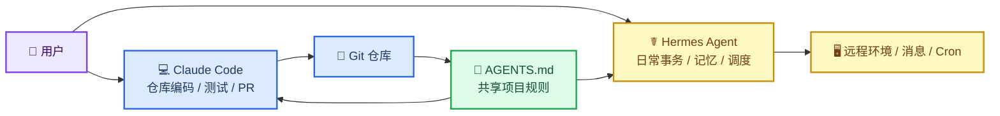
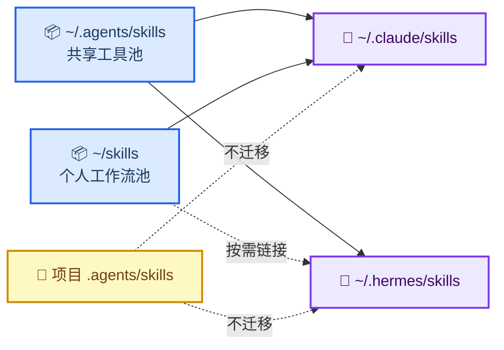
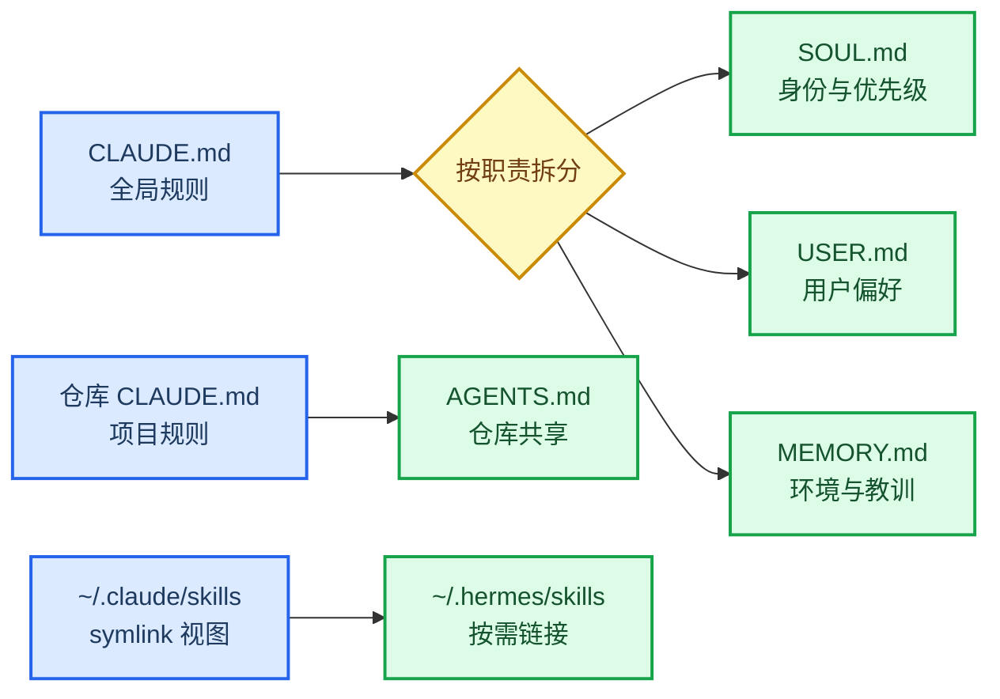
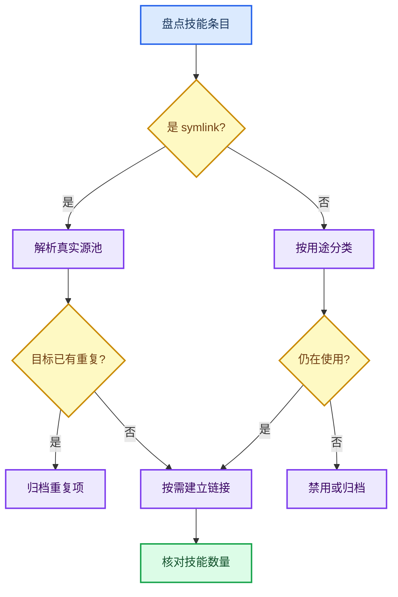
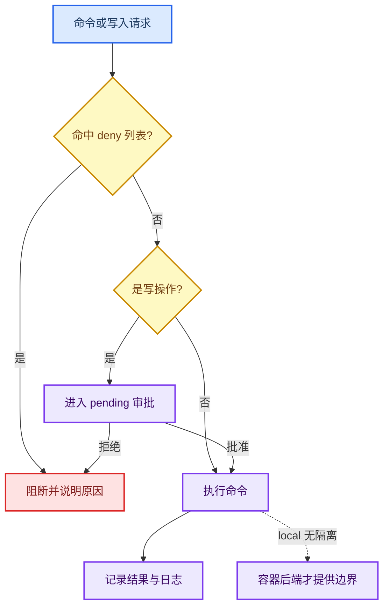

# 从 Claude Code 迁移到 Hermes Agent：边界、步骤与踩坑复盘

_一次“不复制配置、只迁移职责”的实践 · 难度：中等 · 最后验证：2026-10-22_

> 说明：文中主机名、IP、账号已脱敏。命令与配置基于 macOS + Hermes Agent v0.22.4 + Claude Code 的实测；不同版本请以 `--help` 和官方文档为准。

---

## 📋 概述

### 为什么要写这篇

Claude Code 是很强的仓库内编码 agent：读代码、改多文件、跑测试、提交、开 PR。但当任务从“改代码”扩展到“每天在多个系统之间来回处理事务”时，问题会变成另一类：

- 用户偏好、环境信息、历史结论散落在不同会话里；
- 每次新会话都要重新解释同样的背景；
- 远程环境、消息平台、定时任务没有统一的入口；
- 项目规则和用户画像混在同一套 `CLAUDE.md` 里。

Hermes Agent 的定位恰好补这一块：它是一个常驻的、带 profile 级记忆和多种入口的 agent。于是这次迁移的目标不是“把 Claude Code 换成 Hermes”，而是**把职责拆开**：

- 仓库内编码继续用 Claude Code；
- 日常事务、跨系统协调、远程环境运维、消息与定时任务交给 Hermes；
- 项目规则用 `AGENTS.md` 共享，用户与环境信息进 Hermes 的 `USER.md` / `MEMORY.md`。

### 结论先行

- **不要做 1:1 配置镜像。** Claude Code 的配置是“编码 agent 的行为策略”，Hermes 的是“长期 agent 的身份 + 记忆 + 技能”。
- **先盘点技能源池，再迁移。** `~/.claude/skills` 和 `~/.hermes/skills` 很多时候只是 symlink 视图，真正的源在 `~/.agents/skills`、`~/skills` 这类目录里。
- **全量导入会制造重复。** 本次 `hermes import-agent claude-code --dry-run` 预览出 73 项，其中 69 个技能；直接导入会让 Hermes 的技能索引接近翻倍。
- **记忆要分层。** `SOUL.md` 放身份与语气，`USER.md` 放用户偏好，`MEMORY.md` 放环境事实与教训；项目规则留给 `AGENTS.md`。
- **硬约束不能只靠 prompt。** hooks 不会自动迁移，危险命令要靠 `approvals.deny`、写审批和容器隔离。
- **迁移后不是“配置更多”，而是“边界更清楚”。** 本次最终：技能从 116 enabled 收到 77 enabled / 27 disabled；常驻记忆 17 条；MCP 只保留 Context7；pending 队列为 0。

### 你会学到什么

- Claude Code 与 Hermes Agent 的定位差异，以及为什么不是替代关系
- 如何盘点分散的技能目录，避免把 symlink 视图当源目录
- 如何把全局 `CLAUDE.md` 拆成 `SOUL.md` / `USER.md` / `MEMORY.md`
- 如何安全迁移技能、MCP、权限与运行时配置
- 本次实际踩过的坑：重复导入、共享 symlink、项目上下文 first-match、hooks 不迁移、DeepSeek 网页 API 评估、依赖漏洞

---

## 0. 两者不是替代关系

### 定位差异

| 维度 | Claude Code | Hermes Agent |
|---|---|---|
| 核心场景 | 仓库内编码、测试、git/PR、CI | 常驻日常事务、跨系统协调、消息、定时任务 |
| 形态 | CLI、IDE 插件、桌面、Web、移动端 | CLI/TUI、桌面、Web Dashboard、消息网关 |
| 模型 | 以 Claude 为主，支持第三方 provider 接入 | 模型无关，可切 provider / 本地模型 |
| 记忆 | 仓库级 `CLAUDE.md` + auto memory | profile 级 `USER.md` / `MEMORY.md` + 会话检索 |
| 自动化 | hooks、subagents、Routines、Agent SDK | 内置 cron、gateway、skills 自改进 |
| 扩展 | MCP、plugins、Agent SDK | MCP、plugins、skills |
| 许可与成本 | 商业产品、订阅/API 计费 | MIT 开源自托管，付模型/托管成本 |
| 最适合 | 一个仓库里的深度编码 | 跨项目、跨系统的长期事务 |



*Figure 1: Claude Code 与 Hermes 的职责边界。*

这张图是整篇文章的骨架：**Claude Code 负责“仓库里怎么改”，Hermes 负责“什么时候、在哪里、跨哪些系统做”**。两者共享项目规则，但不共享各自的记忆实现。

### 为什么要迁移“日常”，而不是迁移“编码”

这次迁移的触发点不是编码能力，而是日常工作的上下文连续性：

- Hermes 的 `USER.md` / `MEMORY.md` 是 profile 级、跨项目的，适合记住“用户是谁、环境是什么、过去踩过什么坑”；
- Claude Code 的 `CLAUDE.md` / auto memory 是仓库级的，适合记住“这个仓库怎么构建、怎么测试、有哪些约定”；
- 把两者强行合并，会让一个仓库的规则污染另一个项目，也会让用户画像被塞进代码规范里。

所以最终选择是：**Claude Code 保留编码，Hermes 接管日常**。

---

## 1. 迁移前：先盘点，不要先导入

### 技能不是一套目录，而是“源池 + 视图”

本次盘点发现，本机至少有三类技能位置：

| 位置 | 角色 |
|---|---|
| `~/.agents/skills` | 共享工具技能源池，Claude/Hermes 都可能 symlink 到这里 |
| `~/skills` | 个人工作流源池，偏个人流程、文档、环境管理 |
| `~/.claude/skills` | Claude 的视图，大部分是 symlink |
| `~/.hermes/skills` | Hermes 的视图，部分 symlink、部分真目录 |
| `<repo>/.agents/skills` | 项目本地技能，按仓库隔离，不参与全局迁移 |



*Figure 2: 技能源池与 agent 视图的关系。*

本次实测的几个数字：

- 共享源池约 60 个条目，个人源池约 28 个；
- Claude 视图 67 个条目，其中 64 个是 symlink；
- Hermes 视图 59 个条目，其中 43 个是 symlink；
- Hermes 曾有 59 个 `openclaw-imports` 重复目录，和共享源池高度重叠；
- Hermes 当时 116 个 enabled 技能，其中 56 builtin、60 local。

> ⚠️ **关键认知**：`~/.claude/skills` 不是源目录。把它当源去复制，会把 symlink 展开成真实目录，制造第二份副本；以后两边各自修改，就开始漂移。

### 记忆也分两层

Claude Code 的全局 `~/.claude/CLAUDE.md` 本质是“编码 agent 的行为策略”，不是“用户画像”。它包含：

- 优先级与安全约束
- 执行前确认规则
- 语言与输出偏好
- shell 使用预算
- 文档与图表规范

这些内容不能整段塞进 Hermes 的 `MEMORY.md`。原因：

- `MEMORY.md` 上限 2,200 字符，`USER.md` 上限 1,375 字符；
- 写满会直接报错，不会自动压缩；
- 记忆是冻结快照，写入后要新会话才生效；
- 大量程序性规则会挤掉真正需要跨会话记住的环境事实。

---

## 2. 迁移步骤

整个迁移按“先盘点、再备份、后写入、最后验收”推进；任何一步失败都能回到上一个基线。

```mermaid
flowchart LR
    accTitle: Migration Execution Pipeline
    accDescr: Read-only inventory leads to backup, memory split, skill consolidation, security hardening, MCP cleanup and runtime tuning; verification either records a rollback point or sends the work back for correction.

    audit["只读盘点<br/>源池 / 规则 / MCP"] --> backup["备份与基线"]
    backup --> split["拆分记忆与规则"]
    split --> skills["技能去重与补链"]
    skills --> guard["安全与写审批"]
    guard --> mcp_cleanup["MCP 收敛"]
    mcp_cleanup --> runtime["并发与预算"]
    runtime --> verify{"验收通过?"}
    verify -->|"是"| done["记录基线 / 回滚点"]
    verify -->|"否"| rollback["回滚并修正"]

    classDef step fill:#dbeafe,stroke:#2563eb,stroke-width:2px,color:#1e3a5f
    classDef decision fill:#fef9c3,stroke:#ca8a04,stroke-width:2px,color:#713f12
    classDef success fill:#dcfce7,stroke:#16a34a,stroke-width:2px,color:#14532d
    classDef danger fill:#fee2e2,stroke:#dc2626,stroke-width:2px,color:#7f1d1d

    class audit,backup,split,skills,guard,mcp_cleanup,runtime step
    class verify decision
    class done success
    class rollback danger
```



*Figure 3: 迁移执行流程与验收回滚分支。*

### Step 0：备份与基线

```bash
hermes backup
hermes doctor
hermes status --full
hermes config check
```

先把配置、技能、记忆、会话库打一个包；再记录 doctor/status/config 的基线。  
本次备份约 3,858 个文件，压缩后约 18 MB。

### Step 1：拆分全局规则

| 内容 | 落点 | 规则 |
|---|---|---|
| 身份、语气、优先级、安全立场 | `~/.hermes/SOUL.md` | 只放稳定行为，不放项目事实 |
| 用户角色、语言、确认习惯、工具偏好 | `~/.hermes/memories/USER.md` | ≤ 1,375 字符 |
| 环境地址、稳定路径、历史教训 | `~/.hermes/memories/MEMORY.md` | ≤ 2,200 字符，一行一条 |
| 项目构建/测试/架构约定 | `<repo>/AGENTS.md` | 项目级，Claude/Hermes 共享 |
| 多步流程、工具用法 | `~/.hermes/skills/<name>/SKILL.md` | 按需加载，不常驻 |

规则和记忆不是按文件搬家，而是按职责重新落位。下面的图把“同一份源规则会落到哪里”和“技能、项目规则各自去哪”放在一起看：



*Figure 4: 规则、记忆、项目规则与技能的迁移落点。*

左侧是源，右侧是目标。全局 `CLAUDE.md` 被拆成多个文件，项目规则留在仓库，技能视图只按需建立链接。

一个最小的 `SOUL.md`：

```markdown
# Identity
你是 Hermes，长期运行的个人与工程 agent。
你负责常驻入口、记忆、调度、跨系统协调和日常事务；
仓库内编码、测试、git/PR 优先交给 Claude Code。

# Priorities
1. 安全与授权 > 正确性 > 效率 > 简洁
2. 破坏性/不可逆操作先确认
3. 不确定时标注“未验证”，不编造
4. 结论先行；细节按需展开
```

一个最小的 `USER.md`：

```markdown
身份：中文母语；技术术语、命令、API、报错保留英文原文。
§
工作分工：日常编码、测试、git/PR 用 Claude Code；
Hermes 负责日常事务、跨系统协调、远程环境运维、消息/定时任务和长期记忆。
§
确认习惯：创建/修改/删除文件、写配置、执行落地命令，先给方案，
等“执行/按方案X/可以”；只读排查可直接做；一次授权只覆盖当次方案。
```

注意两点：

1. **不要写密钥、token、个人信息。**
2. **改完要新开会话验证。** 记忆是启动时加载的冻结快照；在同一条会话里问“你记得吗”，经常只是旧快照。

### Step 2：技能迁移——先补链接，再去重

先看导入预览：

```bash
hermes import-agent claude-code --dry-run
```

本次预览结果：73 项，其中 69 个技能，另有 MCP 冲突和 secret 剥离提示。  
直接 `--yes` 会把 69 个技能复制到 `~/.hermes/skills/claude-code-imports/`，和已有的 symlink 视图重复。

实际做法：

1. 只补 Hermes 顶层缺失的共享技能链接（本次 11 个，主要是 Lark 扩展和 `smart-search`）；
2. 只补 3 个个人技能：环境管理（`env-manager`）、`markdown-mermaid-writing`、`contradiction-analysis`；
3. 归档 59 个 `openclaw-imports` 重复目录（移到 `~/.hermes/skills/.archive/`）；
4. 用 `hermes skills config` 禁用 27 个低使用技能；
5. 用 `hermes curator pause` 暂停自动维护，迁移稳定后再恢复。

结果：`116 enabled` → `77 enabled, 27 disabled`。

技能迁移不是“能导入就导入”。每个条目都要先判断来源、重复和使用情况：



*Figure 5: 技能迁移的判定路径。*

图中的三个判断点分别对应本次的 symlink 展开、OpenClaw 重复目录和低使用技能。

> ⚠️ **共享 symlink 的双向风险**：Hermes 和 Claude 可能指向同一个 `~/.agents/skills/<name>`。如果 Hermes 自改进直接 patch 这个目录，Claude 也会看到改动。迁移期应开启 `skills.write_approval`，需要 Hermes 独立维护的技能复制成真实目录，不要共用 symlink。

### Step 3：安全与写审批

`hermes config get approvals` 显示默认 `mode: smart`，且 cron/无人值守为 `deny`，但 `deny` 列表为空。补上硬阻断：

```yaml
approvals:
  mode: smart
  deny:
    - "rm -rf *"
    - "rm -fr *"
    - "git clean -fdx*"
    - "git push --force*"
    - "dd if=* of=/dev/*"

memory:
  write_approval: true

skills:
  write_approval: true
  guard_agent_created: true

terminal:
  timeout: 600

updates:
  pre_update_backup: true
```

解释：

- `approvals.deny` 是 fnmatch 护栏，不是 OS sandbox；它不解析变量、别名、函数或重命名后的二进制。
- `skills.write_approval` 会把技能写入 staged 到 `~/.hermes/pending/skills/<id>.json`，需要 `/skills pending`、`/skills diff`、`/skills approve` 人工审核。
- `memory.write_approval` 对记忆写入做同样的事；前台交互会提示，后台/cron 会进 pending。
- `guard_agent_created` 是静态正则安全扫描，不是沙箱；危险内容会报错给 agent，让它重写。
- 无人值守任务最好再上容器后端；`local` 后端没有隔离。

这些护栏的作用点不同，且都不等于 OS 级隔离：



*Figure 6: 命令与写入请求经过的安全护栏。*

`deny` 只做模式匹配，写审批只拦写入；真正需要隔离时，仍要依赖容器或虚拟机。

### Step 4：MCP——只留当前需要的

本次移除了 Hermes 的 `codebase-memory-mcp`：编码主要在 Claude Code，Hermes 不需要代码知识图谱工具，减少一个 MCP 进程和工具面。

新增 Context7：

```yaml
mcp_servers:
  context7:
    url: https://mcp.context7.com/mcp
    lazy: true
```

```bash
hermes mcp test context7
```

实测：

```text
✓ Connected (3950ms)
✓ Tools discovered: 2
  resolve-library-id
  query-docs
```

Context7 适合写脚本前查库的当前 API 和示例，但它返回的是社区贡献片段，不保证准确；关键 API 仍要回官方文档。匿名可用，免费额度约 1,000 次/月，高频再配 `CONTEXT7_API_KEY`。

DeepSeek 的网页 Search/Fetch 也评估过，但本次没有安装。原因是：

- 官方 Search/Fetch API 确实存在，价格低；
- 但 Fetch 不执行 JS、不支持 crawl、每次一个 URL；
- 搜索质量在第三方测试中属于中游；
- 中文优势缺独立基准；
- Hermes 不原生支持 DeepSeek backend，接入需要 MCP 或自建 provider。

结论：保留现有 Tavily/Firecrawl/内置搜索 + Jina Reader 兜底，不为了“便宜”替换提取层。

### Step 5：运行时

本次只做了两处收敛：

```yaml
max_concurrent_sessions: 4

tool_budget:
  mcp_result_size_chars: 50000
```

作用：

- 并发上限防止 gateway/多平台同时跑多个会话时成本失控；
- MCP 结果预算防止 Context7 文档把上下文撑爆。

没有加 fallback：当前主要使用 DeepSeek，按使用习惯接受单 provider 风险。  
`agent.reasoning_effort` 在配置里是 `max`，但 `hermes config get` 提示 key 未识别；CLI 的 `--reasoning` 实测生效，简单任务下 `medium` 与 `max` 延迟差异不明显。

### Step 6：验收

```bash
hermes doctor
hermes status --full
hermes insights
hermes journey
hermes curator status
hermes security audit
```

本次结果：

- 技能：77 enabled / 27 disabled
- 常驻记忆：17 条
- pending：0
- MCP：Context7 only
- Gateway：running，0 platforms，0 cron jobs
- Insights：3 sessions、85,401 tokens、约 $0.0082
- Security audit：42 条已知漏洞，主要集中在 `pillow`、`certifi`、`aiohttp`

---

## 3. 踩坑记录

### 坑 1：把 `~/.claude/skills` 当源目录

**症状**

迁移后 Hermes 出现两份同名技能，修改其中一份，另一份不生效。

**原因**

`~/.claude/skills` 里大量条目是 symlink，真实源在 `~/.agents/skills` 或 `~/skills`。把视图当源复制，会展开成真实目录。

**解决**

先 `readlink` / `find -L` 盘点，按“源池 → 视图”建链接；不要从视图反向复制。

**验证**

```bash
find ~/.claude/skills -maxdepth 1 -type l | wc -l
readlink ~/.claude/skills/<name>
```

### 坑 2：全量 `import-agent` 制造重复技能

**症状**

导入后技能数量从 116 涨到接近 180，触发词冲突，模型经常选错技能。

**原因**

导入预览 73 项、69 个技能；其中很多已经在 Hermes 里以 symlink 形式存在。全量导入会复制到 `claude-code-imports/`，形成第二份。

**解决**

先 `--dry-run`；用 staging 目录只放需要的技能；或导入后立即去重、禁用、归档。

**验证**

```bash
hermes skills list | tail -2
hermes skills list | rg 'disabled' | wc -l
```

### 坑 3：把 `MEMORY.md` 当“全局 CLAUDE.md”

**症状**

记忆写入报错，或者环境事实被大量规则挤掉。

**原因**

`MEMORY.md` 上限 2,200 字符，`USER.md` 上限 1,375 字符；写满不会自动压缩，而是直接失败。

**解决**

把规则拆成：

- 身份/优先级 → `SOUL.md`
- 用户偏好 → `USER.md`
- 环境事实 → `MEMORY.md`
- 程序性流程 → skill
- 项目规则 → `AGENTS.md`

**验证**

```bash
wc -m ~/.hermes/memories/USER.md ~/.hermes/memories/MEMORY.md
hermes journey
```

### 坑 4：项目上下文 first-match

**症状**

明明写了 `AGENTS.md`，Hermes 却不读。

**原因**

Hermes 的项目上下文是 first-match：`.hermes.md` → `AGENTS.override.md` → `AGENTS.md` → `CLAUDE.md` → `.cursorrules`。一旦存在 `.hermes.md`，后面的文件完全不加载。

**解决**

跨工具共享规则放 `AGENTS.md`；只有 Hermes 专属规则才建 `.hermes.md`。本次项目级迁移暂缓，就是这个原因。

**验证**

```bash
hermes --help
# 或直接让 Hermes 复述当前项目规则来源
```

### 坑 5：hooks 不会迁移

**症状**

Claude Code 里能拦截的危险命令，在 Hermes 里没有拦截。

**原因**

Hermes 的 hooks 是 shell hook，不是 Claude Code 的 `PreToolUse` / `PostToolUse` 事件模型；`import-agent` 不迁移 hooks。

**解决**

- 安全关键逻辑 → `approvals.deny` + 容器隔离
- 格式化/通知类 → Hermes plugin 或 wrapper
- 接受无法迁移的部分，并写进文档

**验证**

```bash
hermes hooks list
hermes approvals test '<command>'
```

### 坑 6：共享 symlink 被 Hermes 改掉

**症状**

Hermes 自动改进一个技能后，Claude Code 里的同一技能也变了。

**原因**

两边指向同一个 `~/.agents/skills/<name>`；`skill_manage` 的 patch 会跟随 symlink。

**解决**

- 迁移期开 `skills.write_approval: true`
- 需要 Hermes 独立维护的技能复制成真实目录
- 只读共享技能保留 symlink，但不批准修改

**验证**

```bash
readlink -f ~/.hermes/skills/<name>
hermes skills diff <pending-id>
```

### 坑 7：DeepSeek 网页 API 看起来很美

**症状**

以为 DeepSeek 的 Search/Fetch 能直接替代 Tavily/Firecrawl，实测发现 JS 页面和批量抓取都不行。

**原因**

DeepSeek Fetch 不执行 JS、不支持 crawl、每次只处理一个 URL；搜索质量在第三方测试中属于中游，中文优势缺独立基准。

**解决**

保留现有搜索/提取栈；如果只是想验证中文召回，装 `deepseek-scout-mcp` 跑 5 查询对比，不要直接替换 Tavily。

**验证**

用同一组中文/英文查询对比前 3 条命中、日期、正文完整度，再决定是否接入。

### 坑 8：安全审计不是“可选步骤”

**症状**

配置迁移完成后，`hermes security audit` 报 42 条已知漏洞。

**原因**

Hermes venv 里的 `pillow`、`certifi`、`aiohttp` 版本落后；这不是配置错误，是依赖供应链问题。

**解决**

先 `hermes backup`，再 `hermes update`；仍然存在时再按审计建议升级对应包，不要手改 venv。

**验证**

```bash
hermes security audit
```

---

## 4. 迁移后的收益与边界

| 项 | 迁移前 | 迁移后 |
|---|---|---|
| 技能 | 116 enabled | 77 enabled / 27 disabled |
| 重复源 | 59 个 OpenClaw 副本 | 归档 |
| MCP | codebase-memory | Context7 |
| 常驻记忆 | 0 文件 | 17 条 |
| 写审批 | false | skills + memory 都开 |
| 并发上限 | 无 | 4 |
| MCP 结果预算 | 默认 | 50,000 字符 |
| Fallback | 无 | 仍无（按使用习惯） |
| 安全审计 | 未跑 | 42 条漏洞待修 |

收益：

- Hermes 开始真正“认识用户和环境”，不再每次从零解释；
- 技能索引收敛，触发更稳定；
- 共享 symlink 的修改风险被审批门挡住；
- Context7 补上了写脚本时的 API 查询；
- Claude Code 仍是编码主力，Hermes 成为日常入口和长期记忆。

边界：

- 不是“Claude Code 的所有能力 Hermes 都有”；编码深度仍在 Claude Code。
- 不是“配置越多越好”；技能越少、边界越清楚，路由越稳。
- 不是“开源自托管就没有供应链风险”；本次 42 条漏洞就是例子。
- 没有 fallback 时，DeepSeek 单点故障会直接影响 Hermes。

---

## 5. 还没做的事

- **修安全漏洞**：`hermes update` 后重新审计，确认 `pillow` / `certifi` / `aiohttp` 已升级。
- **修或清理无效 key**：Kimi / MiniMax key 当前 invalid；不用 fallback 的话可以留在 `.env`，也可以清理掉减少 doctor 噪音。
- **项目级 `AGENTS.md`**：本次暂缓；需要时按“共享规则放 AGENTS.md，不建 `.hermes.md`”处理。
- **Gateway / Cron**：当前 gateway 在跑，但没有消息平台和定时任务；等有明确入口需求再做。
- **DeepSeek 中文搜索验证**：如果以后想验证，只装 `deepseek-scout-mcp` 跑 5 查询，不要替换 Tavily 提取层。

---

## 6. 可复用迁移提示词

把下面整段复制给你的 agent，替换尖括号里的占位符即可。提示词按“只读盘点 → 等批准 → 备份 → 记忆/文档 → 技能 → 安全与 MCP → 验收”执行，默认不删除、不覆盖、不提交。

适用场景：

- Claude Code → Hermes Agent
- OpenClaw / 其他 agent → Hermes Agent
- 同一 agent 换机器、换 profile
- 只想迁移技能或只想迁移记忆时，删掉不相关阶段

````text
你是负责 agent 配置迁移的工程师。请把 <源 agent> 的记忆、规则、文档、技能、MCP 和运行时配置迁移到 <目标 agent>。迁移目标是“职责和知识的迁移”，不是 1:1 复制配置文件。

## 输入

- 源 agent：<例如 Claude Code / OpenClaw / 其他>
- 源配置目录：<例如 ~/.claude>
- 目标 agent：<例如 Hermes Agent>
- 目标配置目录：<例如 ~/.hermes>
- 迁移范围：<记忆 / 规则 / 文档 / 技能 / MCP / 定时任务，可多选>
- 是否保留源 agent：<是 / 否>
- 额外约束：<例如必须保留项目级规则、不能改动共享技能目录>

## 硬性规则

1. 先只读盘点，不改任何文件。输出盘点结果和迁移方案，等我明确回复“执行”后再动手。
2. 每一步开始前说明：要改哪些文件、为什么、如何回滚。涉及删除、覆盖、认证、git 提交/推送时单独确认。
3. 不迁移密钥、token、cookie、密码、私钥、shell history、缓存、日志，以及会话数据库中的敏感内容。凭据只通过环境变量或系统 keychain 注入。
4. 不把 symlink 当源文件复制。先解析真实路径，区分“源池”和“视图”。
5. 不做全量导入。先列重复项、冲突项、低价值项，给出保留 / 归档 / 禁用建议。
6. 不凭猜测填配置字段。不确定的配置项先查目标 agent 的 --help、官方文档或本地 schema；查不到就标注“未验证”并跳过。
7. 不自动 git commit / push / merge / deploy；不执行 push --force、reset --hard。
8. 任何“成功”结论都要有命令输出或文件检查作为证据。

## 阶段 0：只读盘点

输出以下内容：

- 源 agent 的记忆 / 规则文件清单：路径、大小、作用、是否项目级
- 文档与提示词清单：路径、用途、是否包含个人信息、是否可共享
- 技能清单：名称、真实路径、来源池、是否 symlink、是否重复、最近是否使用
- MCP 清单：名称、传输方式、是否依赖密钥、是否仍需要
- 自动化清单：hooks、cron、gateway、消息平台、后台任务
- 数据清单：会话、附件、数据库、日志、缓存；标注哪些不应迁移
- 目标 agent 已有的同类配置：列出冲突和覆盖风险

同时给出：

- “建议迁移 / 建议归档 / 建议禁用 / 建议不迁移”四类清单
- 迁移顺序和每步回滚方式
- 预计新增 / 减少的技能数量
- 需要我确认的决策点

盘点完成后停下，等我批准。

## 阶段 1：备份与基线

1. 备份源和目标的关键配置到带日期的目录，保留可读的基线清单。
2. 记录迁移前的技能数量、启用数量、MCP 数量、记忆条数。
3. 不备份密钥；备份文件权限设为仅当前用户可读。
4. 如果目标 agent 支持更新前自动备份，开启并验证一次。

## 阶段 2：记忆与规则拆分

按职责拆分，不要整文件照搬：

- 身份、语气、优先级 → SOUL.md 或等价文件
- 用户画像与长期偏好 → USER.md 或等价文件
- 环境事实、踩坑教训、稳定结论 → MEMORY.md 或等价文件
- 项目级规则 → 项目根目录 AGENTS.md；不要塞进全局记忆
- 一次性任务上下文、临时路径、过期信息 → 不迁移

约束：

- 严格遵守目标 agent 的字符上限；超限时先合并同义条目，再删过期条目。
- 不写入个人信息、内网地址、账号、密钥。
- 每条记忆只表达一个事实；写明来源或验证日期。
- 记忆是快照，写入后说明“下个会话生效”。

## 阶段 3：文档与数据迁移

文档：

- 把源 agent 的规则文档、提示词、参考手册按“全局 / 项目 / 个人”分类。
- 可共享的规则放项目 AGENTS.md 或仓库 docs；私有的放目标 agent 的 references。
- 不把整篇长文档塞进记忆；记忆只放索引和结论，细节留在文档里。
- 对外分享前脱敏：删除 IP、账号、公司名、内部路径。

数据：

- 会话历史默认不迁移；如确需保留，先导出摘要或索引，脱敏后再放入目标 agent 的知识库。
- 原始数据库、日志、缓存、附件默认不迁移；需要时单独确认存储位置和保留期限。
- 不迁移包含凭据、个人信息、生产环境数据的文件。

## 阶段 4：技能迁移

1. 先画清技能源池和视图：哪些目录是真实源，哪些是 symlink。
2. 按“目标 agent 是否已有 / 是否重复 / 是否仍使用”筛选，只迁移需要的技能。
3. 优先用 symlink 共享源池，避免复制出第二份可 drift 的副本；Windows 或不支持 symlink 的环境改为复制，并在报告中注明。
4. 重复技能先归档，不直接删除；归档目录带日期。
5. 迁移后列出：新增、跳过、归档、禁用，以及每个技能的真实路径。
6. 如果目标 agent 支持写审批 / 技能扫描，开启并说明它只是护栏，不是沙箱。

## 阶段 5：MCP、权限与运行时

- MCP：只保留仍在使用、且能说明用途的 server；需要密钥的用环境变量引用，不写明文；逐个测试连接。
- 权限：配置危险命令拒绝清单、写审批、更新前备份；说明这些是静态护栏，不是 OS 级隔离。
- 运行时：并发、超时、结果大小预算按实际负载设置，不抄默认值。
- hooks：确认目标 agent 是否支持；不支持就明确写“未迁移”，不要假装等价。
- 定时任务 / 消息网关：没有明确入口需求时先不启用。

## 阶段 6：验收

运行目标 agent 自带的诊断命令，并逐项报告：

- 配置解析是否通过
- 技能数量、启用 / 禁用数量是否符合预期
- MCP 连接是否成功
- 记忆文件是否在上限内、是否可读
- 写审批、拒绝清单、备份是否生效
- 是否有无效密钥、已知漏洞、待处理队列
- 与原基线对比：新增 / 减少 / 未变

最后输出：

1. 变更文件清单（路径 + 变更类型）
2. 未迁移项及原因
3. 回滚步骤
4. 需要我后续处理的风险
5. 一条可复制的最终验收命令

## 停止条件

- 盘点阶段结束必须停，等我批准。
- 任何删除、覆盖、认证改动、git 提交 / 推送前必须停。
- 发现密钥、个人信息、生产环境凭据时立即停止并报告，不要写入任何文件。
- 目标 agent 版本与文档不一致时，以本地 --help 和实际行为为准，并在报告中标注差异。
````

使用建议：

- 第一次只跑“阶段 0”，确认盘点表没有漏项，再批准后续阶段。
- 如果只想迁移技能，把阶段 2、3、5 标记为“跳过”，并在报告中写明原因。
- 迁移完成后保留基线清单和回滚步骤，至少保留一个版本周期。

---

## 参考资料

- [Hermes Agent 官方文档](https://hermes-agent.nousresearch.com/docs/)
- [Hermes 导入其他 agent](https://hermes-agent.nousresearch.com/docs/user-guide/import-from-other-agents)
- [Hermes Memory](https://hermes-agent.nousresearch.com/docs/user-guide/features/memory)
- [Hermes Skills](https://hermes-agent.nousresearch.com/docs/user-guide/features/skills)
- [Hermes MCP](https://hermes-agent.nousresearch.com/docs/user-guide/features/mcp)
- [Hermes Security](https://hermes-agent.nousresearch.com/docs/user-guide/security)
- [Claude Code Memory](https://code.claude.com/docs/en/memory)
- [Claude Code Security](https://code.claude.com/docs/en/security)
- [AGENTS.md 标准](https://agents.md/)
- [Context7](https://github.com/upstash/context7)
- [DeepSeek Search/Fetch](https://api-docs.deepseek.com/zh-cn/guides/search)
- [Anthropic Context Engineering](https://www.anthropic.com/engineering/effective-context-engineering-for-ai-agents)

---

_最后验证：2026-10-22 · 基于 macOS + Hermes Agent v0.22.4 + Claude Code_
