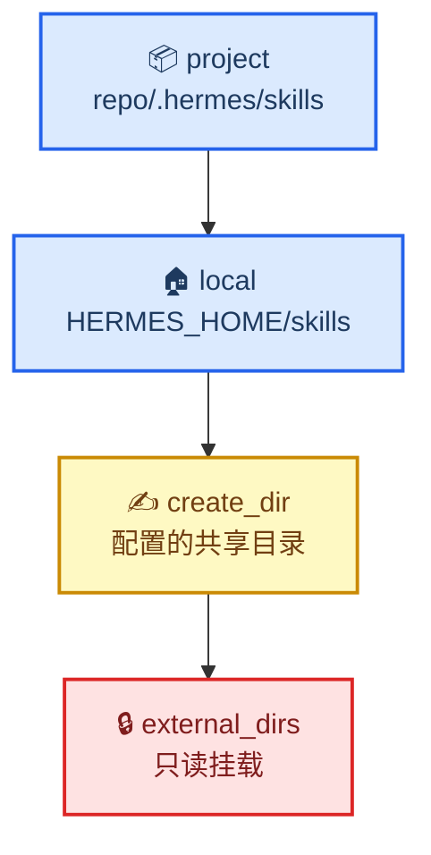

# Hermes Skill 的加载、只读与写入机制

> **文档用途**：说清 Hermes 的 skill 从哪些目录加载、哪些能改、新建落到哪、加了路径为什么不生效。写给要维护技能库的人，也写给需要替人操作技能库的 agent。
> **验证环境**：Hermes Agent v0.22.4（2026.9.24，git 安装 @ `4d04303`）· macOS 15.6.1 · 2026-10-29 实测
> **最后更新**：2026-10-29

---

---

## 0. 怎么读这份文档

| 你要做的事 | 直接跳到 |
|---|---|
| 让另一个 Agent 自己去查、自己去改 | §1 执行卡（整段复制） |
| 搞懂「技能是怎么进到 prompt 的」 | §2 三步加载 |
| 知道同名技能谁赢、为什么报 Ambiguous | §3 四个 tier |
| 判断某个技能能不能被 agent 改 | §4 只读 vs 可写 |
| 把共享目录 / 项目目录挂进来 | §5 添加新路径 |
| 确认新建技能落在哪 | §6 写入位置 |
| 技能没生效、写不进去、approve 失败 | §7 排错 |
| 列表 41 个但目录只看到 22 个 | §8 数字对不上 |

---

## 1. 交给 Agent 执行

> 把下面整段复制给任何跑在 Hermes 上的 agent，它就能独立判断技能来源、写入位置和只读边界，不必再读源码。人类读者可以跳过本节。

::: details 复制即用的 Agent 执行卡（30 行，点开后整段复制）

```text
你运行在 Hermes Agent 上。处理任何 skill 相关问题（技能在哪、为何不生效、能否新建、为何写不进）时按以下事实判断，不要凭印象：

【1. 加载顺序】4 层，数字小者优先
   project    <repo>/.hermes/skills 与 <repo>/.agents/skills（需 hermes skills trust 过该仓库）
   local      $HERMES_HOME/skills（永远扫描）
   create_dir skills.create_dir（配置了且目录存在）
   external   skills.external_dirs[]（只读）
   跨层同名：高层赢，低层被 shadow。同层同名但内容不同：报 Ambiguous，用相对路径区分，不要猜。
   $HERMES_HOME 默认 ~/.hermes；其他 profile 在 ~/.hermes/profiles/<name>。

【2. 注入方式】
   prompt 里只有 frontmatter 的 name + description；正文要 skill_view(name) 才加载，
   附件用 skill_view(name, file_path="references/x.md")。
   "列表里没有" ≠ "不存在"：先查是否 disabled、是否在未挂载的根目录下。

【3. 可写性】最易误判的一条
   可写：local、create_dir
   只读：external（skill_manage 与 curator 均拒绝）、project（加载前过 skills_guard，dangerous 直接隔离）
   软链特例：索引侧 os.walk(followlinks=True) 跟随软链，写入侧 Path.rglob 不跟随，
   因此能列出、能 skill_view，但 skill_manage 报 Skill '<name>' not found in active profile。
   处理：先 realpath $HERMES_HOME/skills/<name> 确认真实目录，再用 patch/write_file 直接改，
   不要反复 approve，也不要怀疑 profile 名写错。

【4. 新建落盘】
   默认 $HERMES_HOME/skills/<category>/<name>/SKILL.md（category 可省略 → 直接 <name>/）
   配了 skills.create_dir 则改写到该目录；create_dir 等于 skills 目录本身时视为未设置。
   新建时 description ≤ 60 字符（超了整批回滚），细节写正文；patch 已有技能不受此限。

【5. 先验证再回答】
   hermes skills list --source local
   hermes skills list --enabled-only | wc -l
   find $HERMES_HOME/skills -name SKILL.md -not -path '*/.archive/*' | wc -l

【6. 硬边界】
   配置只用 hermes config set <key> <value>，绝不手写 config.yaml（缩进错会打断运行中的 gateway）。
   改内置技能（source=builtin）前先 hermes skills list-modified。
   skills.write_approval=true 时，skill_manage 一律先 stage 到 pending，需用户 /skills approve <id> 才落地。
```

:::

配套说明：`skill_manage` 的批量写入失败有四个常见原因，全部会**整批回滚**，处置见 §7.2。

---

## 2. 三步：扫描 → 注入 → 按需加载

Hermes 的技能分三步生效。三步共用同一套根目录顺序，所以「列表里能看到」和「实际能加载」不会脱节。


| 步骤 | 做什么 | 源码位置 |
|---|---|---|
| ① 扫描 | 遍历所有根目录，收集 `SKILL.md` | `agent/skill_utils.py` `get_skill_search_roots()` |
| ② 注入 | 只把 `name` + `description` 写进 system prompt 的 `<available_skills>` | `agent/prompt_builder.py` `build_skills_system_prompt()` |
| ③ 按需加载 | `skill_view(name)` 才读正文；`file_path=` 读附件 | `tools/skills_tool.py` |

**为什么只注入描述**：技能库动辄几十上百个，全量注入正文会让 prompt 直接爆掉。索引行只让 agent 知道「有这个能力」，需要时才付加载成本。`skills.auto_load` 是唯一例外 —— 列进去的技能每次会话整篇预载。

**缓存**：索引有 manifest 签名缓存，任何 `SKILL.md` 变动都会让 key 失效、下一轮重建，不用重启进程。但**已注入当前会话的 prompt 不会自动刷新** —— 改完技能要新会话才看得到。

**扫描规则**：

- 递归扫描，`os.walk(followlinks=True)` —— **跟随符号链接**
- 跳过 `EXCLUDED_SKILL_DIRS`：`.git` `.github` `.hub` `.archive` `.curator_backups` `.locks` `.venv` `venv` `node_modules` `site-packages` `__pycache__` 等
- 跳过技能包内部的支持目录：`references` `templates` `assets` `scripts`（只能通过 `file_path` 显式加载）

**目录布局**（两种都合法）：

```text
$HERMES_HOME/skills/
├── <name>/SKILL.md              # 扁平：自建技能通常这样
├── <category>/<name>/SKILL.md   # 分类：内置技能都是这种
└── .archive/                    # 归档，不扫描
```

---

## 3. 四个 tier 与优先级



| tier | 路径 | 何时生效 | 可写 |
|---|---|---|---|
| `project` | `<repo>/.hermes/skills`、`<repo>/.agents/skills` | `skills.project_discovery: true`（默认）**且**该仓库在 `skills.trusted_project_dirs` | 否 |
| `local` | `$HERMES_HOME/skills` | 永远 | **是** |
| `create_dir` | `skills.create_dir` | 配置了且目录存在 | **是** |
| `external` | `skills.external_dirs[]` | 每项展开 `~` / `${VAR}`（相对 `HERMES_HOME`）后必须是已存在目录 | 否 |

**冲突处理**：

- **跨 tier 同名**：tier 数字小的赢，落败的一份记一条 `resolved by precedence ... not loaded` 日志
- **同 tier 同名、内容不同**：直接报 `Ambiguous skill name`，要求用相对路径区分 —— **不会按目录深度挑一个**（防止 `<root>/evil` 顶掉真技能）
- **同 tier 同名、内容完全相同**（同一 realpath 或字节一致）：去重，取浅的那个

> ⚠️ `external_dirs` 里「等于 local skills 目录」的条目会被跳过，不用为 local 再配一次。

---

## 4. 只读 vs 可写

| 来源 | 能加载 | `skill_manage` 写入 | curator 清理 |
|---|---|---|---|
| `local`（`$HERMES_HOME/skills`） | ✅ | ✅ | ✅ |
| `create_dir` | ✅ | ✅ | ✅ |
| `external`（`external_dirs`） | ✅ | ❌ 拒绝 | ❌ 只读 |
| `project`（trust 过） | ✅ | ❌ | ❌ |
| 软链目录 | ✅ 跟随 | ❌ 找不到 | 取决于真实路径 |

### 4.1 软链：索引跟，写入不跟

这是最容易误判的一条，因为两侧用了**不同的遍历方式**：

| 侧 | 实现 | 是否跟随软链 |
|---|---|---|
| 索引 / `skill_view` | `os.walk(followlinks=True)` | **是** |
| `skill_manage` 收集目标 | `Path.rglob("SKILL.md")` | **否** |

现象：`hermes skills list` 能看到，`skill_view` 能打开，但 `skill_manage` 报 `Skill '<name>' not found in active profile '<profile>'` —— 看起来像 profile 或名字写错，其实不是。

**解决**：`realpath $HERMES_HOME/skills/<name>` 找到真实目录 → 直接用编辑工具改真实文件，绕开 `skill_manage`。不要反复 approve，也不要改 profile 名。

### 4.2 项目技能还有一道安全门

`project` 层的每个 `SKILL.md` 加载前过 `skills_guard` 扫描（按内容 hash 缓存）。verdict = dangerous 的技能被**隔离**：不出现在索引、`skills list`、`skill_view`、斜杠命令里。

这是防 `git pull` 注入的机制，不是配置错误。看到项目技能「明明在目录里却加载不出来」，先怀疑这一条。

---

## 5. 添加新路径

```bash
# ① 挂载共享目录（只读）—— 最适合和 Claude Code 共用一套技能
hermes config set skills.external_dirs '["~/.agents/skills"]'
#    多目录：'["~/.agents/skills", "/srv/team/skills"]'
#    目录不存在 = 静默跳过，只留 debug 日志

# ② 让新建技能落到指定目录（可写）
hermes config set skills.create_dir '~/code/my-skills'

# ③ 项目级技能（仓库内 .hermes/skills 或 .agents/skills）
hermes skills trust /path/to/repo
hermes skills untrust /path/to/repo

# ④ 每次会话整篇预载（慎用，持续占上下文）
hermes config set skills.auto_load '[hermes-agent, skills-pending-triage]'
```

**选择建议**：

| 需求 | 用哪个 |
|---|---|
| 和 Claude Code 共用一套技能，agent 不需要改它们 | `external_dirs`（只读，最干净） |
| 要让 agent 自己迭代这些技能 | 必须落在 `local` 或 `create_dir`（软链只能解决「看得到」，解决不了「写得进」） |
| 技能跟着仓库走、随 PR review | `project` tier + `hermes skills trust` |
| 只在某个仓库生效 | 同上 |
| 每次会话都需要的核心技能 | `auto_load`（会持续占 prompt） |

---

## 6. 写入位置

`skill_manage` 决定落盘位置的逻辑只有三行：

```python
base = $HERMES_HOME/skills          # 默认
base = skills.create_dir or base    # 配了就用配置值
path = base / (category or "") / name
```

| 场景 | 落盘路径 |
|---|---|
| 未配 `create_dir`（默认） | `$HERMES_HOME/skills/<name>/SKILL.md` |
| 传了 `category` | `$HERMES_HOME/skills/<category>/<name>/SKILL.md` |
| 配了 `create_dir` | `<create_dir>/<category?>/<name>/SKILL.md` |
| `create_dir` 等于 skills 目录 | 视为未设置 |

### 6.1 审批门

`skills.write_approval: true` 时，`skill_manage` 的每次变更都先 stage 成 pending JSON（`$HERMES_HOME/pending/skills/<id>.json`），必须 `/skills approve <id>` 才落地，`/skills reject <id>` 丢弃。

后台 review 产生的变更走同一条路，且带 `origin: background_review` —— 意味着**没人审批过的技能改动不该被当作既定事实**。

---

## 7. 排错

### 7.1 现象 → 先查什么

| 现象 | 先查 | 常见原因 |
|---|---|---|
| 技能从列表里消失 | `ls -l $HERMES_HOME/skills` 看是不是软链 | 软链被删或已被展开成副本；`external_dirs` 没配；文件在 `.archive` 里 |
| `skill_view` 报 Ambiguous | `find $HERMES_HOME/skills -name SKILL.md \| grep <name>` | 同 tier 两个不同技能同名，用相对路径区分 |
| `skill_manage` 报 not found | `realpath $HERMES_HOME/skills/<name>` | 目标是软链；或技能在 `external`/`project` 层（只读） |
| 改了 `SKILL.md` 但会话里没生效 | 是不是同一个会话 | 索引会重建，但已注入的 prompt 不刷新，需新会话 |
| approve 后文件没变 | `ls $HERMES_HOME/pending/skills \| wc -l` | 整批回滚，见 §7.2 |
| 内置技能被改坏 | `hermes skills list-modified`、`hermes skills diff <name>` | 用 `hermes skills reset <name>` 清掉 user-modified 标记 |

### 7.2 pending 整批回滚的四个原因

| 原因 | 报错特征 | 处置 |
|---|---|---|
| 安全扫描拦截 | verdict DANGEROUS | `skills.guard_agent_created: true` 时扫的是**整个 skill 目录**，大文档型 skill 会累计大量 CRITICAL。临时 `hermes config set skills.guard_agent_created false` → 批完改回 |
| 同一文件同一行被多条 pending 改 | `old_string` 不匹配 | 先批的那条落地后，后一条锚点失效。**一次只批一条，核验后再批下一条** |
| `create` 的描述超限 | `Description is N chars` | 压到 ≤ 60 字符，细节搬正文 |
| 目标目录是软链 | `Skill not found in active profile` | 见 §4.1，直接改真实目录 |

---

## 8. 数字对不上时

典型困惑：`hermes skills list` 说 41 个，但 `$HERMES_HOME/skills` 顶层只看到 22 个目录。

原因：**顶层的 22 个 = 10 个技能目录 + 12 个分类目录**，内置技能都装在分类目录里。

```bash
hermes skills list --source local    # 自建的
hermes skills list --source builtin  # 内置的（散在分类目录里）
hermes skills list --enabled-only | wc -l                                   # 实际生效
find $HERMES_HOME/skills -name SKILL.md -not -path '*/.archive/*' | wc -l   # 磁盘上的
```

实测基线（2026-10-29，default profile）：

| 项 | 值 |
|---|---|
| `all`（含 disabled） | 67 |
| `builtin` | 57 |
| `local` | 10 |
| `hub` | 0 |
| `enabled-only` | **41** |
| 物理 `SKILL.md`（排除归档） | 68 |
| `.archive/` 里的 | 50（不扫描） |

内置技能的源头是安装包里的 `<install>/skills/`（58 个 `SKILL.md`），安装/升级时 seed 到 `$HERMES_HOME/skills/<分类>/`。`.bundled_manifest` 记录基线；改过内置技能用 `hermes skills list-modified` 查，`hermes skills opt-out` 可彻底停掉 seed。

> ⚠️ **读配置时不要用裸 `python3` 导入 `agent.skill_utils`** —— 会缺 `ruamel.yaml` 报 `ModuleNotFoundError`，而报错点落在 `_config_cache_key` 内，看起来像「配置读不出来」。用 Hermes 自带的解释器：`~/.hermes/tools/python-3.14*/bin/python3 -I`。

---

## 参考资料

- [Hermes Agent 官方文档](https://hermes-agent.nousresearch.com/docs/)
- [Hermes Agent 皮肤（skin）配置详解](./hermes-skin-theme.md) —— 同一套「查字段 / 动手做 / 交给 Agent」的组织方式，本文是它在技能维度的对位
- [从 Claude Code 迁移到 Hermes Agent](./claude-to-hermes-migration.md) —— 迁移时如何划清两边职责，本文的「共存姿势」是其中一环

---

_最后验证：2026-10-29 · 基于 Hermes Agent v0.22.4（git @ `4d04303`）· macOS 15.6.1_
