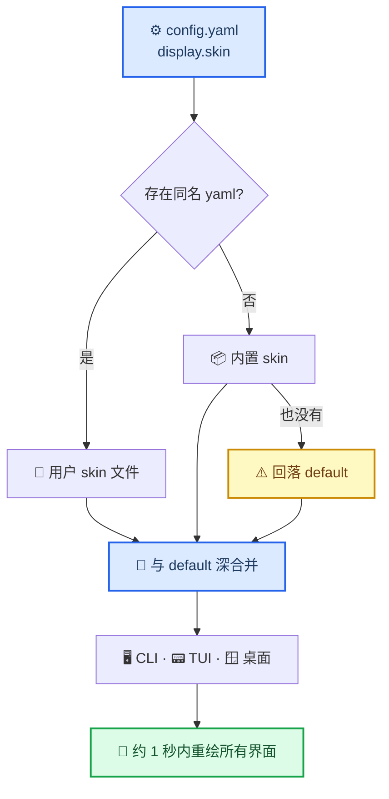

# Hermes Agent 皮肤（skin）配置详解

> **文档用途**：把一份 skin YAML 的每个字段讲清楚 —— 它控制界面的哪一处、不写时会继承什么、改完在哪里生效。写给想照着做一套自己主题的人。
> **验证环境**：Hermes Agent v0.22.4（2026.9.24，git 安装）· macOS 15.6.1 · 2026-10-29 实测
> **最后更新**：2026-10-29

---

---

## 0. 怎么读这份文档

按四种用途分区：**查字段**去 §2，**动手做**去 §3，**看成品**去 §4，**出问题**去 §5。不用从头读到尾。

| 你要做的事 | 直接跳到 |
|---|---|
| 抄一份现成配色，改两处就用 | §4.1 全文 + §3.1 激活 |
| 从零写一份自己的 skin | §3.2（字段查 §2） |
| 把一张图变成横幅图案 | §3.3 |
| 让另一个 Agent 帮你配 | §3.4 |
| 只看某个 key 控制哪一处 | §2.2 的颜色表 |
| 配了没生效、颜色不对 | §5 排错 |
| 找官方文档或可视化工具 | §6 资源 |

---

## 1. 一份 YAML 如何变成整个界面



### 1.1 文件位置与查找顺序

| 场景 | 路径 |
|---|---|
| 默认 home | `~/.hermes/skins/<name>.yaml` |
| 激活了 profile | `$HERMES_HOME/skins/<name>.yaml`，即 `~/.hermes/profiles/<profile>/skins/` |

`load_skin(name)` 的查找顺序：先看 `skins/<name>.yaml` → 再看内置（`default` / `ares` / `mono` / `slate` / `daylight` / `warm-lightmode` / `poseidon` / `sisyphus` / `charizard`）→ 都没有就回落 `default`，并在日志里留一行 `Skin '<name>' not found, using default`。

**文件名决定能否被找到**（`display.skin` 的值必须等于文件名去掉 `.yaml`），YAML 里的 `name:` 只用于列表显示与 GUI 标识。两者写成一致最省心。文件里没有 `name:` 键会被当成无效文件、静默忽略。

### 1.2 合并规则：叠在 default 上，不是覆盖

`colors`、`spinner`、`branding` 三块与 `default` 做一层深合并（`{**default, **你的}`）。后果有三个：

- 只写 6 个颜色也是合法 skin，其余全部继承 `default` 的金色 + 藏青；
- 想彻底摆脱 default 的痕迹，得把「看得见的位置」逐个写掉 —— 状态栏、补全菜单、选区、会话栏；
- `light_colors` / `dark_colors` **不参与合并**：空着表示「这一极性没有手调版本」，交给 TUI 按终端底色自动适配。

### 1.3 生效方式

`display.skin` 落盘后，网关的 skin watcher 会重绘 CLI、TUI、桌面三类界面，约 1 秒。`hermes skin set` 直接修改当前 skin 文件，同样热生效，不需要重启。

### 1.4 三类界面各读什么

| 界面 | 实现 | 主要消费的 key |
|---|---|---|
| CLI | prompt_toolkit，`hermes_cli/skin_engine.py` 的 `_STYLE_PALETTE` | `banner_*`、`input_rule`、`response_border`、`status_bar_*`、`completion_menu_*`、`ui_label`、`ui_ok/warn/error`、`voice_status_bg` |
| TUI（`hermes --tui`） | `ui-tui/src/theme.ts`，先取色、再按真实底色派生 | 全部 `colors`，含 `ui_text`、`ui_border`、`ui_tool`、`ui_thinking`、`diff_*`、`syntax_*`、`selection_bg`、`shell_dollar` |
| 桌面 / 网页 | theme-sdk | 同一份调色板派生面与强调色；`background` 决定底色，`customCSS` 注入原始 CSS |

三处**不是一一对应**：`ui_accent` 只作用于 TUI，CLI 的强调色是 `banner_accent`；`ui_text` 只影响 TUI，CLI 正文用 `banner_text`。改完最好两个界面各看一眼。

---

---

## 2. 字段参考

skin 的 schema 分三层：顶层字段 → `colors` 调色板 → `spinner` / `branding` 等外观块。**这一节是唯一的事实来源**，其余章节只引用，不复述。

### 2.1 顶层字段

| 字段 | 类型 | 作用 | 不写时 |
|---|---|---|---|
| `name` | str | 皮肤标识，列表与 GUI 显示用 | 文件被当作无效，静默忽略 |
| `description` | str | `hermes skin list` 里的一句话说明 | 空 |
| `colors` | map | 主色板，见 §2.2 | 全部继承 default |
| `light_colors` | map | 浅色终端下的覆盖层（叠在 `colors` 上） | 空 = 由 TUI 自动适配 |
| `dark_colors` | map | 深色终端下的覆盖层 | 同上 |
| `spinner` | map | 等待 / 思考动画的表情、动词、翅膀，见 §2.3 | 继承 default（default 为空 → 代码内置默认） |
| `branding` | map | 品牌文案，见 §2.4 | 继承 default 的 Hermes 品牌 |
| `tool_prefix` | str | 工具调用行的统一前缀符号 | `┊` |
| `tool_emojis` | map | 按工具名覆盖 emoji | `{}`，用工具自带 |
| `banner_logo` | str | Rich markup 的 ASCII 字标 | 空 = 沿用内置字标 |
| `banner_hero` | str | Rich markup 的主视觉图案 | 空 |
| `customCSS` | str | 桌面 / 网页注入的原始 CSS，上限 32 KiB | 空 |

> ⚠️ `customCSS` 是**驼峰**。写成 `custom_css` 不会报错，只会被静默忽略。

---

### 2.2 `colors`：按元素分组

「生效面」只标已验证的 CLI / TUI；桌面界面通过 theme-sdk 派生，不逐 key 对应。
「不写时」= 与 default 合并后的值；default 里没有的 key 写明 TUI 的派生来源。

**文字层级**

| key | 作用 | 生效面 | 不写时 |
|---|---|---|---|
| `banner_title` | 标题、主文字；TUI 的 primary 来源 | CLI/TUI | default `#FFD700` |
| `banner_text` | 正文、通用文字；TUI 正文的回退 | CLI/TUI | default `#FFF8DC` |
| `ui_text` | TUI 正文（优先于 `banner_text`） | TUI | 回退 `banner_text` |
| `banner_dim` | 次要文字、树形连接线、思考正文的来源 | CLI/TUI | default `#B8860B` |
| `ui_primary` | TUI 标题 / 主文字 | TUI | 回退 `banner_title` |
| `prompt` | 提示符**符号**的颜色 | CLI/TUI | 回退 `banner_text` |

> `prompt` 只染符号，**不染你输入的文字** —— `input-area` 样式留空，输入区继承终端自己的前景色。想让输入文字变色，只能改终端主题。

**边框与线条**

| key | 作用 | 生效面 | 不写时 |
|---|---|---|---|
| `banner_border` | CLI 边框；TUI 边框的回退 | CLI/TUI | default `#CD7F32` |
| `ui_border` | TUI 边框、分隔线、沟槽 | TUI | 回退 `banner_border` |
| `input_rule` | 输入框上边线；clarify / approval / sudo 弹窗的边框 | CLI | default `#CD7F32` |
| `response_border` | 回复块左边框 | CLI | default `#FFD700` |
| `session_border` | 会话标题栏边框 | TUI | 回退 `banner_dim` |

**强调色**

| key | 作用 | 生效面 | 不写时 |
|---|---|---|---|
| `ui_accent` | TUI 强调：标题、链接、雪佛龙、工具标记的取色来源 | TUI | 回退 `banner_accent` |
| `banner_accent` | CLI 强调（`accent` 样式）；TUI accent 的回退 | CLI/TUI | 回退 `ui_warn` |
| `ui_label` | 标签类：图片徽章、语音状态、菜单 meta 当前项 | CLI/TUI | 回退 `banner_title` |
| `session_label` | 会话名标签 | TUI | 回退 `banner_dim` |
| `ui_tool` | 工具调用标记（`●` 与工具 spinner） | TUI | 派生，通常等于 accent |

**语义状态**

| key | 作用 | 生效面 | 不写时 |
|---|---|---|---|
| `ui_ok` | 成功 / 健康 | CLI/TUI | default `#4caf50` |
| `ui_warn` | 警告 | CLI/TUI | default `#ffa726` |
| `ui_error` | 错误 | CLI/TUI | default `#ef5350` |
| `ui_thinking` | 思考、推理正文 | TUI | 回退 `banner_dim` |

**状态栏**

| key | 作用 | 生效面 | 不写时 |
|---|---|---|---|
| `status_bar_bg` | 状态栏底色；TUI 里也是 subagent dock 与各分段的底 | CLI/TUI | default `#1a1a2e` |
| `status_bar_text` | 状态栏正文 | CLI/TUI | 回退 `banner_text` |
| `status_bar_strong` | 状态栏强调值；**同时是会话标题徽章的底色**（徽章文字取 `status_bar_bg`，形成反色） | CLI/TUI | 回退 `banner_title` |
| `status_bar_dim` | 状态栏次要信息 | CLI/TUI | 回退 `banner_dim` |
| `status_bar_good` | 健康 / 正常 | CLI/TUI | 回退 `ui_ok` |
| `status_bar_warn` | 警告 | CLI/TUI | 回退 `ui_warn` |
| `status_bar_bad` | 偏差（如上下文将满） | CLI/TUI | CLI 回退 `banner_accent`；TUI 用派生值 |
| `status_bar_critical` | 严重 | CLI/TUI | 回退 `ui_error` |

> `status_bar_strong` 兼作徽章背景，所以它必须是**能压住深色反字**的浅色。把它调暗会让会话标题徽章糊成一团。

**补全菜单与选区**

本节除 `selection_bg`（仅 TUI）外，均由 CLI 与 TUI 共用。

| key | 作用 | 不写时 |
|---|---|---|
| `completion_menu_bg` | 补全菜单底色；TUI 里也是面板 surface 的首选 | default `#1a1a2e` |
| `completion_menu_current_bg` | 当前选中行底色；TUI 选区的回退 | default `#333355` |
| `completion_menu_meta_bg` | meta 列底色 | 回退 `completion_menu_bg` |
| `completion_menu_meta_current_bg` | meta 当前项底色 | 回退 `completion_menu_current_bg` |
| `selection_bg` | 文本 / 列表选区底色 | 回退 `completion_menu_current_bg` |

**底色、shell 与语音**

| key | 作用 | 生效面 | 不写时 |
|---|---|---|---|
| `background` | 应用底色。写了之后 TUI 会用它刷终端底色（OSC-11）并据此判定明暗极性；桌面界面由它派生 | TUI/GUI | 空 = 沿用终端自身底色 |
| `shell_dollar` | shell 模式（`!` 命令）下 `$` 提示符的颜色 | TUI | 派生 |
| `voice_status_bg` | 语音状态条的底色 | CLI | 回退 `status_bar_bg` |

**diff 与代码高亮**

| key | 作用 | 生效面 | 不写时 |
|---|---|---|---|
| `diff_added` / `diff_removed` | diff 增删行的底色 | TUI | 内置 diff 色阶 |
| `diff_added_word` / `diff_removed_word` | 词级高亮 | TUI | 内置 |
| `syntax_string` / `syntax_number` / `syntax_keyword` | 代码高亮的字符串 / 数字 / 关键字 | TUI | 按 accent、text、border 派生 |
| `syntax_comment` | 注释 | TUI | 回退 `banner_dim` |

**两层回退不要混**

- **CLI 层**：查表（`_STYLE_PALETTE`）+ 固定兜底。值给什么用什么。
- **TUI 层**：取色 → 按真实底色派生 → 对比度地板修正。太暗或极性不对的颜色会被抬到可读，或者被换成派生值。

所以同一个 hex 在两边观感可能不同，**别拿 CLI 的效果去推断 TUI**。

---

### 2.3 `spinner`

```yaml
spinner:
  waiting_faces: [✨, 🌙, ☕]        # 等待首个 token 时轮换
  thinking_faces: [✳️, 🧠, ⚙️]      # 思考 / 工具执行中轮换
  thinking_verbs: [thinking, reasoning, sketching]
  wings:                            # [左, 右] 成对，包在表情两侧，可给多组轮换
    - [⟪✨, ✨⟫]
```

| 字段 | 作用 |
|---|---|
| `waiting_faces` | 发出请求后、还没收到首个 token 时轮换的图案 |
| `thinking_faces` | 思考与工具执行期间轮换的图案 |
| `thinking_verbs` | 与图案搭配的动词短语 |
| `wings` | 列表的列表：每个元素必须是两个字符串（左、右），单层列表会被忽略 |

全空 = 继承 default；default 的 `spinner` 本身为空，实际落到 `display.py` 的硬编码默认。

### 2.4 `branding`

| 字段 | 作用 | 不写时 |
|---|---|---|
| `agent_name` | 启动横幅与品牌名 | `Hermes Agent` |
| `welcome` | 启动欢迎语 | Hermes 默认欢迎语 |
| `goodbye` | 退出语 | `Goodbye! ☤` |
| `response_label` | 回复块左侧标签；首尾空格会被保留，用来做留白 | default 的 ` ☤ Hermes ` |
| `prompt_symbol` | 交互提示符符号；加载时 strip 并补一个空格 | `❯` |
| `help_header` | `/help` 的标题 | `(^_^)? Available Commands` |

`prompt_symbol: "🐾 >_:"` 实际渲染为 `🐾 >_: `（末尾自动补一个空格）。

### 2.5 `tool_prefix` 与 `tool_emojis`

```yaml
tool_prefix: 🛠️
tool_emojis:
  terminal: 🐚
  web_search: 🔎
```

- `tool_prefix`：所有工具调用行前面的统一符号，默认 `┊`
- `tool_emojis`：键是工具名，覆盖该工具的默认 emoji；没列出的继续用默认

### 2.6 `banner_logo` 与 `banner_hero`

```yaml
banner_logo: |-
  [bold #5997d9]第一行字标[/]
  [dim #c4d959]第二行小字[/]
```

- 用 `|-` 块标量保留换行，每行一个 Rich markup 片段
- 语法：`[bold #5997d9]` 是「修饰 + `#rrggbb` 色」，`[/]` 闭合；`[dim #c4d959]` 可组合
- 两处颜色**写死在字符串里，不跟随 `colors`** —— 换主题色时不同步改字标，会出现「新配色 + 旧色字标」的混搭
- 行宽超过终端宽度会折行错位，按目标终端宽度对齐
- 从图片生成字标 / 主视觉的方法见 §3.3

### 2.7 `customCSS`

- 只在桌面 / 网页主题里作为 `<style>` 注入，CLI 与 TUI 完全不读
- 上限 32 KiB，超出部分被截断
- 内容不做安全过滤（源码注释明确写了「themes are user-authored YAML」）—— 别把来源不明的 skin 直接丢进来

---

---

## 3. 操作

### 3.1 快速开始

```bash
# 1) 放到 skin 目录（profile 环境下是 ~/.hermes/profiles/<profile>/skins/）
cp my-skin.yaml ~/.hermes/skins/my-skin.yaml

# 2) 确认被识别：source 列显示 user，行首 * 表示当前生效
hermes skin list

# 3) 激活（写入 display.skin，网关约 1 秒内重绘所有界面）
hermes skin use my-skin
#    等价于：hermes config set display.skin my-skin

# 4) 回滚
hermes skin use default
```

`hermes skin list` 的真实输出：

```text
  default          builtin  Classic Hermes — gold and kawaii
  ares             builtin  War-god theme — crimson and bronze
  mono             builtin  Monochrome — clean grayscale
  slate            builtin  Cool blue — developer-focused
  daylight         builtin  Light theme for bright terminals with dark text and cool blue accents
  warm-lightmode   builtin  Warm light mode — dark brown/gold text for light terminal backgrounds
  poseidon         builtin  Ocean-god theme — deep blue and seafoam
  sisyphus         builtin  Sisyphean theme — austere grayscale with persistence
  charizard        builtin  Volcanic theme — burnt orange and ember
* darcikes         user     Darcikes 自定义的agent
```

只改一个颜色，不必重写整份文件：

```bash
hermes skin set ui_accent '#00ffff'        # 改当前 skin 的这一项
hermes skin set banner_border '#c4d959' --skin darcikes   # 指定某个 skin
```

`set` 只接受 `#rrggbb`（校验正则是 `^#[0-9a-fA-F]{6}$`），写入后热生效。若目标是内置 skin，它会先复制出一份 `<name>-custom.yaml` 再改，避免破坏内置主题。

> ⚠️ **不要手改 `config.yaml` 来切皮肤。** 走 `hermes skin use` / `hermes config set`：写出来的 YAML 一定合法，手改错一个缩进就可能让正在运行的网关读不到配置。

---

### 3.2 从零写一份 skin

**最小骨架**

```yaml
name: my-skin
description: 一句话说明这套配色

colors:
  background: "#11151c"                 # 写了就由 skin 接管终端底色
  banner_title: "#e6edf3"
  banner_text: "#c9d1d9"
  banner_dim: "#7d8a99"
  banner_border: "#3b82f6"
  ui_border: "#3b82f6"
  ui_accent: "#3b82f6"
  banner_accent: "#3b82f6"
  ui_ok: "#4ade80"
  ui_warn: "#fbbf24"
  ui_error: "#f87171"
  status_bar_bg: "#0b0f14"
  status_bar_text: "#c9d1d9"
  status_bar_strong: "#e6edf3"
  status_bar_dim: "#7d8a99"
  completion_menu_bg: "#0b0f14"
  completion_menu_current_bg: "#1f2937"
  selection_bg: "#1f2937"
```

**步骤**

1. 先定 `background`：深浅极性从这里开始，后面所有颜色都对着它校验。
2. 文字拉三档：`banner_title` / `banner_text` / `banner_dim`，层次靠亮度差，不靠颜色差。
3. 定强调色：`ui_accent`（TUI）与 `banner_accent`（CLI）通常同色；和底色对比度争取 ≥ 4.5:1。
4. `ui_ok` / `ui_warn` / `ui_error` 保持绿 / 黄 / 红语义，别拿它们当装饰色。
5. 把三块深色面补齐：`status_bar_*`、`completion_menu_*`、`selection_bg`，否则会露出 default 的藏青。
6. `hermes skin use my-skin` 后分别看 CLI 和 `hermes --tui`，两边的取色逻辑不同。

**明暗双极性**

| 做法 | 结果 |
|---|---|
| 不写 `background` | 跟随终端；浅色终端触发 TUI 的自动适配与 ANSI 归一化 |
| 写 `background` | 皮肤接管极性，TUI 用它刷终端底色；深浅由你负责 |
| 写 `background` + `light_colors` | 浅色终端用 `light_colors` 覆盖层（只写要改的 key，会叠在 `colors` 上） |
| 写 `background` + `dark_colors` | 同上，面向深色终端 |

**交付前检查**

- [ ] 文件名 == `display.skin` 的值 == YAML 里的 `name`
- [ ] 所有颜色是 `#rrggbb`
- [ ] `hermes skin list` 里能看到，且行首带 `*`、source 为 `user`
- [ ] 正文与状态栏底色对比度 ≥ 4.5:1
- [ ] CLI 与 TUI 各看一遍
- [ ] 浅色终端下也看一眼，或补 `light_colors`
- [ ] 字标 / 主视觉里的硬编码 hex 与主题色同步

---

### 3.3 用图片生成 banner_logo / banner_hero

**结论：可行，但转换必须发生在写 YAML 之前。** Rich 渲染的是字符串，`banner_*` 里放不了图片路径或二进制，所以流程固定为「图片 → 字符画 → Rich 标记字符串」。Hermes Mod 走的是同一条路：上传 PNG / JPG / GIF / WEBP，选渲染风格，再写进 `banner_hero`。

§4.1 里的 `banner_hero` 就是盲文点阵——一份图片转换出来的成品。

**两个字段分别放什么**

| 字段 | 内容 | 建议尺寸 | 常用字符集 |
|---|---|---|---|
| `banner_logo` | 文字字标（产品名 / 昵称） | 宽 ≤ 100 列，6 行左右 | 半角方块、figlet 大字 |
| `banner_hero` | 图片主视觉（图案、图标、人像） | 宽 20–40 列，10–20 行 | 盲文点阵（细节最好）、ASCII 渐变 |

**转换脚本**

只依赖 Pillow，脚本如下（点击展开）：

::: details 转换脚本（保存为 img2art.py）

```python
#!/usr/bin/env python3
"""image -> Rich-markup 文字画（Hermes skin 的 banner_logo / banner_hero）

依赖：pip install pillow

用法：
  python3 img2art.py hero.png --mode braille --width 30 --color '#c4d959' --dim
  python3 img2art.py logo.png --mode ramp --width 60 --color '#5997d9'

输出每行一段 Rich 标记，直接粘进 skin YAML 的 banner_hero / banner_logo 块。
"""
import argparse

from PIL import Image

RAMP = " .:-=+*#%@"  # 暗 → 亮
BRAILLE_BITS = (
    (0, 0, 0x01), (0, 1, 0x02), (0, 2, 0x04), (1, 0, 0x08),
    (1, 1, 0x10), (1, 2, 0x20), (0, 3, 0x40), (1, 3, 0x80),
)
BLANK = {" ", "\u2800"}


def load(path, invert=False):
    im = Image.open(path)
    if im.mode in ("RGBA", "LA") or (im.mode == "P" and "transparency" in im.info):
        # 透明区域合成到黑底，否则 alpha 通道会被当成纯黑
        im = im.convert("RGBA")
        im = Image.alpha_composite(Image.new("RGBA", im.size, (0, 0, 0, 255)), im)
    img = im.convert("L")
    return Image.eval(img, lambda v: 255 - v) if invert else img


def trim(rows):
    while rows and set(rows[0]) <= BLANK:
        rows.pop(0)
    while rows and set(rows[-1]) <= BLANK:
        rows.pop()
    return rows


def ramp_art(img, width):
    # 终端字符约 1 宽 2 高，行数减半才能保持比例
    height = max(1, round(img.height / img.width * width * 0.5))
    small = img.resize((width, height))
    px = small.load()
    return ["".join(RAMP[px[x, y] * (len(RAMP) - 1) // 255] for x in range(width))
            for y in range(height)]


def braille_art(img, width, threshold=128):
    # 一个盲文字符 = 2×4 个点，点间距在终端里近似正方
    cols = width * 2
    rows = max(4, round(img.height / img.width * cols))
    rows -= rows % 4
    small = img.resize((cols, rows))
    px = small.load()
    out = []
    for cy in range(0, rows, 4):
        line = []
        for cx in range(0, cols, 2):
            bits = 0
            for dx, dy, bit in BRAILLE_BITS:
                if px[cx + dx, cy + dy] >= threshold:  # 亮像素点亮
                    bits |= bit
            line.append(chr(0x2800 + bits))
        out.append("".join(line))
    return out


def main():
    ap = argparse.ArgumentParser()
    ap.add_argument("image")
    ap.add_argument("--mode", choices=("braille", "ramp"), default="braille")
    ap.add_argument("--width", type=int, default=30, help="每行字符数")
    ap.add_argument("--threshold", type=int, default=128, help="braille 阈值 0-255")
    ap.add_argument("--invert", action="store_true", help="浅底深主体时加这个")
    ap.add_argument("--color", default="", help="如 #c4d959；留空输出纯文本")
    ap.add_argument("--dim", action="store_true", help="加 dim 修饰")
    ap.add_argument("--no-trim", action="store_true", help="保留上下空白行")
    args = ap.parse_args()

    img = load(args.image, args.invert)
    rows = (braille_art(img, args.width, args.threshold) if args.mode == "braille"
            else ramp_art(img, args.width))
    if not args.no_trim:
        rows = trim(rows)

    if args.color:
        style = ("dim " if args.dim else "") + args.color
        rows = [f"[{style}]{r}[/]" for r in rows]
    print("\n".join(rows))

if __name__ == "__main__":
    main()
```

:::

用法：

```bash
pip install pillow

# 图片 → 盲文点阵，30 列宽，青柠色 + dim
python3 img2art.py hero.png --mode braille --width 30 --color '#c4d959' --dim

# 图片 → ASCII 渐变，浅底深主体时加 --invert
python3 img2art.py logo.png --mode ramp --width 60 --color '#5997d9' --invert
```

输出就是可以整段粘进 YAML 的行，例如：

```text
[dim #c4d959]⠀⠀⠀⠀⠀⠀⣀⣀⠀⠀⠀⠀⠀⠀⠀⠀⠀⠀⠀⠀⠀⠀[/]
[dim #c4d959]⠀⠀⠀⠀⢀⣠⣴⣾⣿⣿⣿⣿⣿⣿⣷⣦⣄⡀⠀⠀⠀⠀⠀⠀⠀⠀[/]
```

贴进去的位置：

```yaml
banner_hero: |-
  [dim #c4d959]⠀⠀⠀⠀⠀⠀⣀⣀⠀⠀⠀⠀⠀⠀⠀⠀⠀⠀⠀⠀⠀⠀[/]
  [dim #c4d959]⠀⠀⠀⠀⢀⣠⣴⣾⣿⣿⣿⣿⣿⣿⣷⣦⣄⡀⠀⠀⠀⠀⠀⠀⠀⠀[/]
```

脚本对透明背景做了处理（RGBA / LA / 带 transparency 的调色板图会先合成到黑底），并默认裁掉上下空白行。

**约束：决定成品能不能用**

| 约束 | 说明 | 违反的后果 |
|---|---|---|
| 宽度 | hero 20–40 列，logo ≤ 100 列 | 超过终端宽度会折行，图案裂开 |
| 行数 | hero 10–20 行 | 太高把正文挤出首屏 |
| 颜色 | 每行一段 Rich 标记 = 整行一色 | 逐像素上色会让 YAML 膨胀到不可维护 |
| 字符宽度 | 只用盲文、方块、ASCII | emoji 是双宽字符，列数对不齐 |
| 透明背景 | 必须合成到底色 | 透明区被当纯黑，图案糊成一团 |
| 阈值 | `--threshold` 调对比，`--invert` 反极性 | 深底图标直接看不见 |
| 字体 | 盲文需要等宽字体含 Braille Patterns 区段 | 显示成方框 |
| 极性 | 亮色字符画只适合深色终端 | 浅色终端下整体发白 |

**什么时候别用图片**

- 只想放名字：figlet 一类的 ASCII 大字更清晰，也更好改
- 目标宽度 < 20 列：细节基本丢光，不如放 emoji 或纯文字
- 需要按品牌色分区上色：Rich 只能整段着色，做不到逐像素配色

**脚本与 Hermes Mod 的分工**

| | 本文脚本 | Hermes Mod |
|---|---|---|
| 适合 | 批量、可复现、脚本化生成 | 交互调参、实时预览 |
| 输入 | 本地图片 | 上传图片或文字 prompt |
| 风格 | 盲文点阵、ASCII 渐变 | 盲文、ASCII 渐变、方块、点阵，可选宽度 |
| 产出 | Rich 标记行 | 直接写 `~/.hermes/skins/*.yaml` |

两者产出的是同一份 YAML：可以先用 Mod 调满意，再用脚本固化到仓库里。

---

### 3.4 交给 Agent 执行

> 把这一节整段发给另一个 Agent，它就能自己完成配置。人类读者可以跳过。

**目标**：在当前 Hermes home 里新增或修改一份 skin 并确认生效，不破坏既有配置。

**步骤**

1. 定位 home：`echo "${HERMES_HOME:-$HOME/.hermes}"` —— profile 环境下这里不是 `~/.hermes`
2. 读现状：`hermes skin list` + 读 `<home>/skins/*.yaml`，挑风格最接近的一份当基线
3. 写文件：`<home>/skins/<name>.yaml`，`name:` 与文件名一致；字段语义查 §2，图片转字标查 §3.3
4. 激活：`hermes skin use <name>` —— **不要手改 `config.yaml`**
5. 验收（缺一项都不算完成）：

   ```bash
   hermes skin list | grep -E '^\*'     # 当前皮肤是本行
   hermes config get display.skin       # 与预期一致
   ```

   再让用户在 CLI 与 `hermes --tui` 各看一眼：两处取色逻辑不同（§1.4）
6. 回滚：`hermes skin use <原皮肤名>`

**硬边界**

- 只改 `display.skin`，不动 `config.yaml` 的其他字段
- 颜色只能 `#rrggbb`；不要复用内置名（§5 坑 5）
- 不写密钥、主机名、内网地址
- 已有皮肤只调一两个颜色时用 `hermes skin set <key> <hex> --skin <name>`，别重写整份
- 用户给图片要做 banner：先按 §3.3 转字符画，Rich 不支持运行期图片

---

## 4. 案例：`darcikes.yaml`

这份配置是「深色终端 + 冷灰文字 + 一抹青柠」的组合：青柠只出现在开头的横幅边框与主视觉，交互元素统一用珊瑚，TUI 的强调色单独走紫罗兰。

### 4.1 完整配置（可直接复制）

下面就是这套 skin 的全文，整段复制到 `~/.hermes/skins/darcikes.yaml` 即可使用（`display.skin` 设为 `darcikes`）。

```yaml
name: darcikes
description: Darcikes 自定义的agent
colors:
  # ── 文字层级 ──
  banner_title: "#e6edf3"
  banner_text: "#c9d1d9"
  ui_text: "#c9d1d9"
  banner_dim: "#7d8a99"
  prompt: "#e6edf3"
  # ── 边框 / 线条 ──
  banner_border: "#c4d959"
  input_rule: "#d97757"
  response_border: "#d97757"
  session_border: "#556378"
  # ── 强调色 ──
  ui_accent: "#9f59d9"
  banner_accent: "#d97757"
  ui_label: "#7eb8f6"
  session_label: "#d97757"
  # ── 语义状态 ──
  ui_ok: "#7bc96f"
  ui_warn: "#e5c07b"
  ui_error: "#e06c75"
  # ── 状态栏 / 补全菜单 / shell：不写会继承 default 的金色+藏青 ──
  status_bar_bg: "#1b2029"
  status_bar_text: "#c9d1d9"
  status_bar_strong: "#e6edf3"
  status_bar_dim: "#7d8a99"
  status_bar_good: "#7bc96f"
  status_bar_warn: "#e5c07b"
  status_bar_bad: "#e08a5f"
  status_bar_critical: "#e06c75"
  completion_menu_bg: "#1b2029"
  completion_menu_current_bg: "#2f3946"
  selection_bg: "#2b3542"
  shell_dollar: "#7eb8f6"
  voice_status_bg: "#1b2029"
spinner:
  waiting_faces:
    - ✨
    - 🌙
    - ☕
    - 🌀
    - ◌
    - ◐
  thinking_faces:
    - ✳️
    - 🧠
    - ⚙️
    - 🔍
    - ✦
    - ◐
  thinking_verbs:
    - thinking
    - reasoning
    - sketching
    - refining
    - checking
    - connecting dots
  wings:
    - - ⟪✨
      - ✨⟫
branding:
  agent_name: ✳ Darcikes Agent
  welcome: ✨ Darcikes ready. Type your message or /help.
  goodbye: 👋 Goodbye!
  response_label: " ✳ Darcikes "
  prompt_symbol: "🐾 >_:"
  help_header: ✳ Available Commands
tool_prefix: 🛠️
tool_emojis:
  terminal: 🐚
  web_search: 🔎
  browser_exec: 🧭
  read_file: 📁
  write_file: 📝
  patch: 🩹
  todo_list: 🎯
banner_logo: |-
  [bold #5997d9]██████╗  █████╗ ██████╗  ██████╗██╗██╗  ██╗███████╗███████╗     █████╗  ██████╗ ███████╗███╗   ██╗████████╗[/]
  [bold #5997d9]██╔══██╗██╔══██╗██╔══██╗██╔════╝██║██║ ██╔╝██╔════╝██╔════╝    ██╔══██╗██╔════╝ ██╔════╝████╗  ██║╚══██╔══╝[/]
  [bold #5997d9]██║  ██║███████║██████╔╝██║     ██║█████╔╝ █████╗  ███████╗    ███████║██║  ███╗█████╗  ██╔██╗ ██║   ██║[/]
  [bold #5997d9]██║  ██║██╔══██║██╔══██╗██║     ██║██╔═██╗ ██╔══╝  ╚════██║    ██╔══██║██║   ██║██╔══╝  ██║╚██╗██║   ██║[/]
  [bold #5997d9]██████╔╝██║  ██║██║  ██║╚██████╗██║██║  ██╗███████╗███████║    ██║  ██║╚██████╔╝███████╗██║ ╚████║   ██║[/]
  [bold #5997d9]╚═════╝ ╚═╝  ╚═╝╚═╝  ╚═╝ ╚═════╝╚═╝╚═╝  ╚═╝╚══════╝╚══════╝    ╚═╝  ╚═╝ ╚═════╝ ╚══════╝╚═╝  ╚═══╝   ╚═╝[/]
banner_hero: |-
  [dim #c4d959]⠀⠀⠀⠀⣠⣾⣿⣿⣿⣿⣿⣿⣿⣿⣿⣿⣿⣿⣿⣿⣿⣿⣿⣿⣿⣿⣿⣿⣿⣄[/]
  [dim #c4d959]⠀⠀⠀⢘⣿⣿⣿⣿⣿⣿⣿⣿⣿⠿⠿⢿⣿⡿⠿⠿⠿⠿⣿⣿⣿⣿⣿⣿⣿⣯⡀[/]
  [dim #c4d959]⠀⠀⠀⢻⣿⣿⣿⣿⠟⠋⠉⠀⠀⠀⠀⠀⠀⠀⠀⠀⠀⠀⠀⠈⠙⠻⣿⣿⣿⣿⠁[/]
  [dim #c4d959]⠀⠀⠀⣾⣿⣿⣿⠃⠀⠀⠀⠀⠀⠀⠀⠀⠀⠀⠀⠀⠀⠀⠀⠀⠀⠀⠹⣿⣿⣿⡆[/]
  [dim #c4d959]⠀⠀⠀⣿⣿⣕⡇⠀⠀⠀⠀⠀⠀⠀⠀⠀⠀⠀⠀⠀⠀⠀⢀⣀⠀⠀⠀⢿⣿⣿⡇[/]
  [dim #c4d959]⠀⠀⠀⣿⢿⡏⠀⠀⢴⣿⣿⣿⣶⣦⡄⠀⠀⠀⠀⣴⣾⣿⣿⣿⣿⣂⣀⣀⢻⢿⡇[/]
  [dim #c4d959]⠀⠀⠀⣹⣾⣿⣿⠿⠿⢿⣿⣿⣿⣿⣷⣦⣤⣤⣶⡿⠟⢻⣿⣿⣿⣿⣿⣿⣿⣿⡇[/]
  [dim #c4d959]⠀⣠⠤⠿⣿⣿⡇⢀⣴⣿⣿⣿⣿⣿⣿⣿⡿⢿⣿⣧⣵⣿⣿⣿⣿⣿⣿⣿⣿⡿⠓⠢⡄[/]
  [dim #c4d959]⣸⠁⢀⠀⡏⣿⣷⣿⣿⣿⣿⣿⣿⣿⣿⡿⠀⠈⣿⣿⣿⣿⣿⣿⣿⣿⣿⣿⡏⡇⡠⠀⢹[/]
  [dim #c4d959]⢿⠀⠀⠑⣧⠘⣿⣿⣿⣿⣿⣿⣿⣿⡿⠁⠀⠀⠘⢿⣿⣿⣿⣿⣿⣿⣿⡟⢠⡟⠀⠀⢸[/]
  [dim #c4d959]⠘⣆⠀⠀⢻⠀⠈⠙⠛⠛⠛⠛⠛⠉⠀⠀⠀⠀⠀⠀⠉⠙⠛⠛⠛⠉⠁⠀⢸⠃⠀⣠⠎[/]
  [dim #c4d959]⠀⠈⠓⠦⢼⡀⠀⠀⠀⠀⠀⠀⠀⠀⡀⠀⢀⣀⣀⠤⠄⠀⠀⠀⠀⠀⠀⠀⣸⠒⠚⠁[/]
  [dim #c4d959]⠀⠀⠀⠀⠀⢧⡀⠀⠀⠀⠀⠀⠀⠀⠉⠉⠉⠀⠀⠀⠀⠀⠀⠀⠀⠀⠀⣠⠃[/]
  [dim #c4d959]⠀⠀⠀⠀⠀⠀⠱⢤⣀⠀⠀⠀⠀⠀⠀⠀⠀⠀⠀⠀⠀⠀⠀⠀⠀⣠⠜⠁[/]
  [dim #c4d959]⠀⠀⠀⠀⠀⠀⠀⢸⠁⠙⣦⣄⣀⣠⠤⢤⠀⠀⠀⠀⣀⣀⣤⡶⠛⢧⡀[/]
  [dim #c4d959]⠀⠀⠀⠀⠀⠀⠀⣸⠀⠀⣷⠟⠉⠀⣠⠞⠛⠛⠛⠉⠉⠀⣿⠁⠀⠀⠙⣦⣄⡀[/]
  [dim #c4d959]⠀⠀⠀⣀⡤⢖⡟⡟⠀⠈⠀⠀⠴⠚⢣⡀⠀⠀⣀⣀⣤⡾⠁⠀⠀⠀⠀⢹⡤⣉⡓⠦⣄[/]
```

> 字标与主视觉的行比较长，代码块里需要横向滚动。粘贴时保持原样、不要手动折行，否则 ASCII 图案会错位。

### 4.2 色系结构

| 色系 | 值 | 用在哪 |
|---|---|---|
| 冷灰文字 | `#e6edf3` / `#c9d1d9` / `#7d8a99` | 标题 / 正文 / 次要 |
| 青柠 | `#c4d959` | `banner_border` + `banner_hero`，只做框和主视觉 |
| 珊瑚 | `#d97757` | `input_rule`、`response_border`、`banner_accent`、`session_label` |
| 紫罗兰 | `#9f59d9` | `ui_accent`，TUI 的标题 / 链接 / 雪佛龙 |
| 深蓝底 | `#1b2029` / `#2f3946` / `#2b3542` | 状态栏、补全菜单、选区 |
| 语义三色 | `#7bc96f` / `#e5c07b` / `#e06c75` | ok / warn / error |

### 4.3 设计取向：为什么几乎全量覆盖

这份配置把 default 的 **28 个 color key 全部重写**，外加 default 里没有的 `ui_text`，共 29 项。这是刻意的：`colors` 与 default 深合并（§1.2），漏掉一个可见位置，界面上就会残留 default 的金色或藏青。

没写的 key 都是「default 也没有」的那批，走 TUI 派生：

| 未写的 key | 实际结果 |
|---|---|
| `background` | 不接管终端底色，跟随终端 |
| `ui_border` | 继承 `banner_border`，TUI 边框也是青柠 |
| `ui_tool` / `ui_thinking` | 分别派生自 accent 与 `banner_dim` |
| `diff_*` / `syntax_*` | 内置或派生色阶 |
| `completion_menu_meta_*` | 回退菜单底色 |

结论：这份 skin 的「完整」来自全量覆盖，不是字段更多。自己写时可以走同一策略，也可以只覆盖看得见的位置（§3.2 的最小骨架）。

### 4.4 对比度实测

以状态栏底色 `#1b2029` 为基准（WCAG 相对亮度公式）：

| 前景 | 对比度 | 判断 |
|---|---|---|
| `banner_title` `#e6edf3` | 13.83 | AA 富余 |
| `banner_text` `#c9d1d9` | 10.59 | AA 富余 |
| `banner_border` `#c4d959` | 10.44 | AA 富余 |
| `ui_warn` `#e5c07b` | 9.46 | AA 富余 |
| `ui_ok` `#7bc96f` | 8.11 | AA 富余 |
| `ui_label` `#7eb8f6` | 7.84 | AA 富余 |
| `status_bar_bad` `#e08a5f` | 6.20 | AA |
| `banner_accent` `#d97757` | 5.23 | AA |
| `ui_error` `#e06c75` | 5.11 | AA |
| `banner_dim` `#7d8a99` | 4.64 | AA 边缘 |
| `ui_accent` `#9f59d9` | 3.82 | 低于 AA 正文线（4.5），高于大字线（3.0） |
| `session_border` `#556378` | 2.68 | 仅作线条，可接受 |

同一组强调色在选中行背景上会更低：`ui_accent` 对 `completion_menu_current_bg #2f3946` 只有 **2.73**，对 `selection_bg #2b3542` 是 **2.90**。TUI 有对比度地板机制会做修正，但 CLI 不会 —— 如果觉得链接、雪佛龙偏暗，把 `ui_accent` 调亮一档最直接。

### 4.5 这套配置的取舍

- **没写 `background`**：皮肤不接管终端底色，默认按深色终端设计；浅色终端下由 TUI 自动适配。
- **没写 `ui_border`**：TUI 边框继承 `banner_border`，于是青柠也成了 TUI 的边框色。若只想让横幅是青柠，得单独写 `ui_border`。
- **`ui_accent` 与 `banner_accent` 不同色**：TUI 的标题 / 链接偏紫，CLI 的强调偏珊瑚。想统一就把 `ui_accent` 改成 `#d97757`。
- **四级告警没有混色**：`good` 绿、`warn` 黄、`bad` 橙、`critical` 红，四个状态各自可辨。
- **`banner_logo` 里的 `#5997d9` 是硬编码的蓝**，与任何 color key 都不联动，换主题色时容易漏改。
- **没写 `light_colors` / `dark_colors`**：两种终端极性共用一套 `colors`，浅色侧依赖自动适配。
- **`tool_prefix` 用 emoji**，比字符前缀抢眼；`tool_emojis` 只覆盖 7 个高频工具，其余用默认。

---

---

## 5. 排错

### 坑 1：改了 YAML，界面还是金色

**症状**

`hermes skin list` 里能看到这个 skin，切过去却没变化。

**原因**

三种常见情况：

1. `display.skin` 的值与文件名不一致（文件名才是查找键）；
2. 改的是 `~/.hermes/skins/` 下的文件，但当前会话跑在某个 profile 下，读的是 `~/.hermes/profiles/<profile>/skins/`；
3. profile 里的软链断了 —— `is_file()` 返回 False，与「文件不存在」无法区分，只会静默回落 default。

**解决 / 验证**

```bash
hermes config get display.skin
test -e ~/.hermes/skins/<name>.yaml && echo OK || echo MISSING
readlink -f ~/.hermes/profiles/<profile>/skins/<name>.yaml   # profile 场景，必须指到真实文件
HERMES_HOME=~/.hermes/profiles/<profile> hermes skin list     # 看该 profile 真正能看见什么
grep -i "not found, using default" ~/.hermes/profiles/<profile>/logs/agent.log | tail -3
```

### 坑 2：只写几个颜色，状态栏还是藏青

**症状**

界面大部分变色了，状态栏、补全菜单、会话栏仍是 default 的深蓝。

**原因**

`colors` 与 default 深合并。`status_bar_bg` 不写就是 `#1a1a2e`，`completion_menu_bg` 也是。

**解决**

把看得见的面逐个写掉：`status_bar_*`、`completion_menu_*`、`selection_bg`、`session_border`。

### 坑 3：同一个 skin 在深色和浅色终端下观感不一样

**原因**

没写 `background` 时，极性由终端决定，TUI 会按终端底色做适配与对比度归一化；写了 `background` 则由皮肤接管。两条路径的取色结果不同。

**解决**

要稳定就写 `background` + `light_colors` 覆盖层；要跟随终端就别写 `background`，并且接受自动适配。

### 坑 4：`customCSS` 写了没反应

**原因**

写成 `custom_css` 会被静默忽略（源码读的是驼峰 `customCSS`）；或者期待它影响 CLI / TUI —— 它只注入桌面与网页主题。

**解决**

```yaml
customCSS: |
  .sidebar { border-radius: 8px; }
```

### 坑 5：和内置 skin 同名

**症状**

文件放进 `skins/`，`hermes skin list` 里看不到；桌面界面也没变成自己的配色。

**原因**

官方文档的口径是「`~/.hermes/skins/` 中的用户皮肤优先于同名内置皮肤」——`load_skin()` 确实如此。但另外两处不是：`hermes skin list` 会跳过与内置同名的用户文件（内置先占位），桌面端也仍可能显示内置主题。三处行为不一致，别赌。

**解决**

换一个新名字（`mono-mine`、`darcikes-custom`），不要复用 `mono` / `slate` / `cyberpunk` / `nous` / `midnight` / `ember` 这类内置名。

### 坑 6：`#rgb` 或颜色名不生效

**原因**

`hermes skin set` 的校验是 `^#[0-9a-fA-F]{6}$`；加载端也不保证解析短写与颜色名。

**解决**

一律 `#rrggbb`，三位缩写和 `red`、`rgb()` 都不要用。

### 坑 7：横幅字标的颜色和主题打架

**原因**

`banner_logo` / `banner_hero` 是 Rich markup 字符串，颜色写死在里面，不跟随 `colors`。

**解决**

换主题色时同步改字标里的 hex；或者干脆只用 `[bold]`，让终端默认色接管。

### 坑 8：`prompt` 改了，输入的文字还是白的

**原因**

`prompt` 只作用于提示符符号。输入区样式是空的，继承终端前景色。

**解决**

这是刻意设计（保证浅色 / 深色终端都能读）。要改输入文字颜色只能改终端主题。

### 坑 9：多 profile 共享皮肤时看不到

**症状**

default home 里好好的 skin，切到某个 profile 就回落 default。

**原因**

`skins/` 是 per-home 的。共享要么把 profile 的 `skins` 目录软链到主目录（从 `profiles/<p>/` 出发是 `../../skins`），要么单个文件链（从 `profiles/<p>/skins/` 出发是 `../../../skins/<name>.yaml`）。

**解决 / 验证**

```bash
readlink -f ~/.hermes/profiles/<profile>/skins          # 必须解析到 ~/.hermes/skins
HERMES_HOME=~/.hermes/profiles/<profile> hermes skin list
```

---

---

## 6. 资源

### 官方文档

- **[快速入门](https://hermes-agent.nousresearch.com/docs/zh-Hans/getting-started/quickstart)**（`zh-Hans/getting-started/quickstart`）—— 安装、选 provider（`hermes setup` / `hermes model`）、跑通第一次对话。皮肤是外观，**先把对话跑通再折腾它**。
- **[皮肤与主题](https://hermes-agent.nousresearch.com/docs/zh-Hans/user-guide/features/skins)**（`zh-Hans/user-guide/features/skins`）—— 官方字段清单、完整 YAML 模板、`/skin` 用法、内置皮肤一览、Hermes Mod 介绍。
- **[英文原版](https://hermes-agent.nousresearch.com/docs/user-guide/features/skins)**（`user-guide/features/skins`）—— 与中文页对照，术语以英文为准。

官方对「怎么切皮肤」写得很明确：

```text
/skin                # 查看当前皮肤并列出可用的
/skin ares           # 切到内置皮肤
/skin mytheme        # 切到 ~/.hermes/skins/mytheme.yaml
```

- `/skin` 只对**当前会话**生效；要永久默认，改的是 `display.skin`（推荐 `hermes config set display.skin <name>`，避免手改 YAML 出错）
- 皮肤文件放 `~/.hermes/skins/`，未知皮肤自动回退 `default`
- 官方同样说明 `banner_logo` / `banner_hero` 用 Rich 标记（`[bold #FF0000]text[/]`）着色

### Hermes Mod（可视化编辑器）

社区项目（Pinokio 应用），官方文档已收录。作用是把「改 YAML」变成「点选 + 实时预览」：列出内置与自定义皮肤、可视化编辑全部字段、文字生成 `banner_logo`、上传图片生成 `banner_hero`（盲文 / ASCII 渐变 / 方块 / 点阵）、保存到 `~/.hermes/skins/`、通过更新 `config.yaml` 激活。

::: details 安装与使用

**安装**

```bash
# 方式一：Pinokio 一键安装（pinokio.computer 里搜索 hermes-mod）

# 方式二：npx，终端最快
npx -y hermes-mod

# 方式三：手动
git clone https://github.com/cocktailpeanut/hermes-mod.git
cd hermes-mod/app && npm install && npm start
```

**使用**

1. 启动应用，打开 **Skin Studio**
2. 选一个内置或自定义皮肤（内置的当模板，先复制再改）
3. 生成 logo / 上传图片做 hero，选渲染风格与宽度
4. 改颜色、spinner、品牌等字段
5. **Save** 写入 `~/.hermes/skins/<name>.yaml`
6. **Activate** 把 `display.skin` 指过去

:::

**注意**

- 产物是同一份 YAML，可与 `hermes skin set` 混用：Mod 出视觉，命令做精修
- 它尊重 `HERMES_HOME`，profile 环境也能用
- 它**会直接写 `config.yaml`**。首次使用前备份 `~/.hermes/config.yaml` 与 `~/.hermes/skins/`，激活后用 `hermes config get display.skin` 复核
- 第三方更新节奏与 Hermes 本体不同步，字段不被识别时回到 §2 手动补

> 本节信息抓取于 2026-10-29 的官方中文文档与 [hermes-mod](https://github.com/cocktailpeanut/hermes-mod) 仓库 README；**Hermes Mod 未在本机安装实测**。

### 源码与相关文章

- [NousResearch/hermes-agent](https://github.com/NousResearch/hermes-agent) —— 关键实现：`hermes_cli/skin_engine.py`（合并与 CLI 调色板）、`ui-tui/src/theme.ts`（TUI 取色与派生）、`hermes_cli/skin_cmd.py`（`skin list/use/set`）
- [从 Claude Code 迁移到 Hermes Agent](./claude-to-hermes-migration.md)

---
