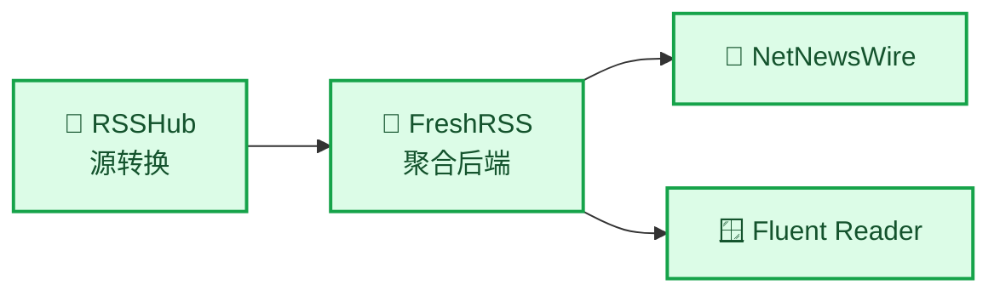
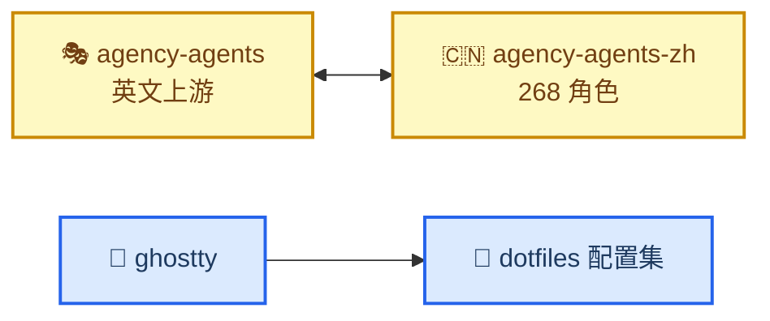

# 内容地图

_全站 27 篇技术文章，按「领域」与「专题」两条线索引 · 最后更新：2026-10-29_

---

## 按领域

六个领域，每个领域有独立入口页（含一句话导语与阅读顺序）。

| 领域 | 收什么 | 篇数 | 入口 |
|---|---|---|---|
| 基础设施 | 机器、网络、部署与托管 | 5 | [infra/index](./infra/index.md) |
| 本地开发 | 编辑器、版本控制、终端 | 4 | [dev/index](./dev/index.md) |
| AI Agent | 客户端迁移、皮肤、技能库、排错与生态 | 9 | [ai/index](./ai/index.md) |
| 自动化与编排 | worktree 编排、浏览器、代码索引、工程流程 | 5 | [automation/index](./automation/index.md) |
| 应用与平台 | iOS、GitHub、RSS | 3 | [platform/index](./platform/index.md) |
| 写作与知识管理 | 文档结构、图表、模板 | 1 | [writing/index](./writing/index.md) |

## 按专题

跨领域的一条线索，按顺序读。

| 专题 | 串起什么 | 篇数 |
|---|---|---|
| [Hermes 上手](./series/hermes.md) | 凭据排错 → 迁移决策 → 外观定制 → 技能机制 | 4 |
| [KVM 实验室](./series/kvm-lab.md) | 装宿主机 → 选客户机 → 远程访问 | 3 |
| [浏览器自动化](./series/browser-automation.md) | 链路选型 → CDP 实操 | 2 |

## 工具链关系

跨领域的依赖只集中在两组，其余都是单点工具：

单点工具（无上下游关系）：Codex++、codebase-memory-mcp、baoyu-skills、Claude CLI 状态栏、Markdown+Mermaid 写作标准。

## 收录标准

- 每篇文章固定结构：**它是什么 → 核心作用 → 安装与使用 → 参考链接 → 踩坑**
- 技术内容按领域归类；跨领域的关系写进 `series/`，不靠目录嵌套
- 星级、版本、价格为记录时的快照，会随时间变动，以各自页面为准
