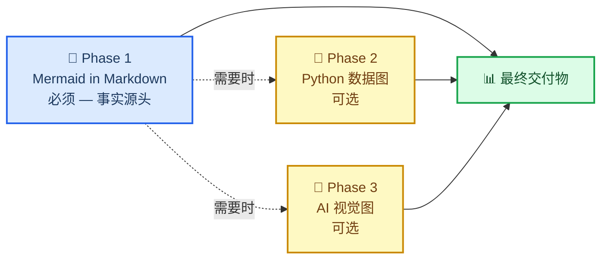

# Markdown + Mermaid 写作技能 — 科学文档的文本化图表标准

_Claude Code 写作技能 + 本地图表规范：用「Markdown 内嵌 Mermaid」作为科学文档的默认格式，让图表保持可 diff、可编辑、随处渲染的文本 · 最后验证：2026-10-23_

> 说明：本文把 `markdown-mermaid-writing` 技能与 `~/.claude/rules/documentation.md` 的图表规范合并成一套可执行标准。示例基于 Mermaid CLI 12.0.0 / Node.js 26 实测；不同渲染器内置的 Mermaid 版本可能不同，以目标平台预览为准。

---

## 📋 这个技能是什么

[SuperiorByteWorks-LLC/agent-project](https://github.com/SuperiorByteWorks-LLC/agent-project) 出品的 `markdown-mermaid-writing` 技能，核心赌注：

> **用 Mermaid 表达的「关系」比任何图片都值钱**——它是文本，git diff 干净；无需构建步骤；GitHub / GitLab / Notion / VS Code 原生渲染；比同样关系的长文描述省 token；随时可转成精美图片，但文本版本永远是事实源头。

| 特性 | Mermaid 内嵌 Markdown | Python / AI 图片 |
| ---- | :-------------------: | :--------------: |
| git diff 可读 | ✅ | ❌ 二进制 |
| 免重新生成即可编辑 | ✅ | ❌ |
| 相对文字更省 token | ✅ | ❌ 更多 |
| 免构建步骤渲染 | ✅ | ❌ 需托管 |
| AI 免视觉解析 | ✅ | ❌ |
| GitHub / GitLab / Notion 可用 | ✅ | ⚠️ 需托管 |

## 🧱 前置需求与依赖

先分清两类依赖：**写作依赖**和**校验依赖**。Mermaid 是纯文本，写作本身不需要构建；`mmdc` 只是本地校验和导出工具，不是写作必需。

| 能力 | 依赖 | 必需性 | 缺失后的表现 |
| ---- | ---- | ------ | ------------ |
| 写作 | Markdown 编辑器 | 必需 | 无法编辑 `.md` |
| 预览 | 支持 Mermaid 的渲染器 | 必需其一 | 只能看源码 |
| 本地校验 | Node.js + npm | 可选 | 无法安装 `mmdc` |
| CLI 渲染 | `@mermaid-js/mermaid-cli`（`mmdc`） | 可选 | 无法批量校验、导出图片 |
| 无头浏览器 | Chromium / Chrome | 随 Puppeteer | `mmdc` 启动失败 |

常见渲染器与依赖差异：

- **GitHub / GitLab**：原生渲染，无需构建；但平台内置的 Mermaid 版本可能滞后。
- **VitePress / VS Code / Notion**：需要对应插件或客户端渲染，支持范围各不相同。
- **较新或实验性图型**：`radar-beta`、`treemap-beta`、`sankey-beta`、`xychart-beta`、`block-beta`、`architecture-beta`、`kanban`、`packet-beta`、`zenuml`。先在目标平台试渲染，再决定是否作为主图。
- **本地 `mmdc` 通过不等于目标平台通过**：最终以 GitHub / 博客 / 文档平台的预览结果为准。

快速检查环境：

```bash
node --version
npm --version
mmdc --version
```

`mmdc` 不是必需项；只有需要本地校验或导出 SVG / PNG 时才安装。

## 🎯 核心工作流：三阶段

| 阶段 | 内容 | 何时用 |
| ---- | ---- | ------ |
| **Phase 1** 📄 | Mermaid in Markdown | **必须**，事实源头，永远提交 |
| **Phase 2** 🐍 | Python 生成（数据图表） | 可选，真实数据散点图等 |
| **Phase 3** 🎨 | AI 生成图片 | 可选，精美视觉 / 写实图 |



*Figure 1: 三阶段文档工作流。Mermaid 是事实源头，数据图和 AI 图只是下游转换。*

## 📐 默认原则

1. 结构、流程、时序、关系类信息优先用 Mermaid 写进 `.md`；截图和导出图片只作为补充，不作为源文件。
2. 图必须内联在相关正文旁，前后各有一句说明；禁止集中堆到「图表」章节。
3. 一图只表达一个主信息。图说不清的部分用表格或正文补充。
4. 精确数值、长条件、逐行配置用表格，不强行画图。

## 🧩 图型选型速查

技能本身带 24 种图型参考；实际写作先按信息形态选，不按图型名硬套。

| 信息形态 | 首选图型 | 不适合 |
| -------- | -------- | ------ |
| 多角色请求 / 响应、API 调用 | `sequenceDiagram` | 简单线性步骤 |
| 步骤、分支、决策逻辑 | `flowchart` | 多角色时序 |
| 单个对象的状态迁移 | `stateDiagram-v2` | 多步骤业务流程 |
| 数据库表与关系 | `erDiagram` | 运行时行为 |
| 类 / 接口 / 领域模型 | `classDiagram` | 数据库 schema |
| 系统逻辑边界 | `C4Context` / `C4Container` | 云资源部署拓扑 |
| 云资源、网络、部署 | `architecture-beta` | 逻辑架构分层 |
| 分层或空间布局 | `block-beta` | 流程逻辑 |
| 排期、里程碑、依赖 | `gantt` | 只有先后的年表 |
| 事件年表、版本历史 | `timeline` | 有工期和依赖的排期 |
| 分支与合并策略 | `gitGraph` | 一般业务流程 |
| 两轴定位、优先级 | `quadrantChart` | 精确数值对比 |
| 多维评分、能力画像 | `radar-beta` | 时间序列 |
| 数值趋势、柱线对比 | `xychart-beta` | 精确读数场景 |
| 单层占比（≤7 类） | `pie` | 类别多或需要精确比较 |
| 层级占比 | `treemap-beta` | 流向和量级 |
| 流量、资源流转 | `sankey-beta` | 简单占比 |
| 概念拆解、头脑风暴 | `mindmap` | 流程和时序 |
| 任务状态板 | `kanban` | 排期和依赖 |
| 用户旅程与满意度 | `journey` | 普通流程 |
| 正式需求追溯 | `requirementDiagram` | 非正式任务板 |

取舍规则：

- **流程三选一**：有分支步骤用 `flowchart`；强调谁在何时给谁发消息用 `sequenceDiagram`；同一实体的状态迁移用 `stateDiagram-v2`。
- **时间三选一**：只有事件用 `timeline`；有工期和依赖用 `gantt`；分支合并用 `gitGraph`。
- **比例三选一**：单层少量用 `pie`；层级用 `treemap-beta`；流向用 `sankey-beta`。
- **比较三选一**：两轴定位用 `quadrantChart`；多维评分用 `radar-beta`；精确数值用表格或 `xychart-beta`。
- **架构三选一**：逻辑边界用 C4；云资源和网络用 `architecture-beta`；分层布局用 `block-beta`。

### 9 种文档模板

Pull Request 记录、Issue / Bug、Sprint 看板、架构决策记录（ADR）、演示文稿、研究论文、项目文档、How-to 教程、状态报告——每种模板开写前可复用。

## 🎨 Mermaid 视觉规范

### 可访问性

每个图必须包含：

```text
accTitle: 3-8 个词的标题
accDescr: 一到两句话，说明这张图表达什么
```

不支持 `accTitle` / `accDescr` 的图型：

`mindmap`、`timeline`、`quadrantChart`、`sankey-beta`、`xychart-beta`、`block-beta`、`kanban`、`packet-beta`、`architecture-beta`、`radar-beta`、`treemap-beta`、`zenuml`。

这些类型在代码块正上方补一行斜体描述，不要强行加 `accTitle` / `accDescr`。`mindmap` 加上任一行都可能导致 `Syntax error in text`，整张图渲染失败。

### 配色

禁止 `%%{init}` 和行内 `style`，统一用 `classDef` + `class`，保证 GitHub light / dark 都能渲染。

| 语义 | classDef |
| ---- | -------- |
| 主流程 / 动作 | `fill:#dbeafe,stroke:#2563eb,stroke-width:2px,color:#1e3a5f` |
| 成功 / 正向 | `fill:#dcfce7,stroke:#16a34a,stroke-width:2px,color:#14532d` |
| 警告 / 注意 | `fill:#fef9c3,stroke:#ca8a04,stroke-width:2px,color:#713f12` |
| 危险 / 异常 | `fill:#fee2e2,stroke:#dc2626,stroke-width:2px,color:#7f1d1d` |
| 中性 / 组件 | `fill:#f3f4f6,stroke:#6b7280,stroke-width:2px,color:#1f2937` |
| 强调 / AI | `fill:#ede9fe,stroke:#7c3aed,stroke-width:2px,color:#3b0764` |
| 存储 / 外部 | `fill:#ffedd5,stroke:#ea580c,stroke-width:2px,color:#7c2d12` |

- 单图最多 4 个语义色。
- 颜色不能单独承载语义，必须同时有文字、形状或标签。
- 序列图不支持 `classDef`，保持默认配色即可。

### 节点与标签

- 节点 ID 用 `snake_case`，动作节点用动词，状态节点用名词；禁止 `A`、`B`、`node1`。
- 标签 3-6 个词，边标签 1-4 个词。
- 每个节点最多 1 个 emoji，放在开头；技术文档可不用 emoji。
- 形状语义固定：

| 语义 | 形状 |
| ---- | ---- |
| 起止 | `([起止])` |
| 过程 | `[过程]` |
| 判断 | `{判断}` |
| 子流程 | `[[子流程]]` |
| 数据库 | `[(数据库)]` |

### 复杂度

| 规模 | 节点数 | 处理 |
| ---- | ------ | ---- |
| 简单 | 1-10 | 平铺 |
| 中等 | 10-20 | 2-4 个子图 |
| 复杂 | 20-30 | 强制子图，考虑概览 + 细节 |
| 极复杂 | 30+ | 拆成多张图 |

- `flowchart` 单图不超过 10 个节点、3 个决策点。
- 方向统一：`LR` 用于流水线 / 时间，`TD` 用于层级 / 决策，不混用。
- 边交叉过多时重排分组或拆图，不要继续加线。

## 🧾 文档结构

- 全文只有一个 H1。
- 标题层级不跳级；每个小节只讲一个主题。
- 比较、配置、字段说明用表格；表格不超过 5 列。
- 长日志、完整输出、补充细节放 `<details>`，不隐藏关键结论。
- `<details>` 结束后加 `---`。
- 图内联在相关正文旁，前后各有一句说明。
- 图下用斜体写图注：`*Figure N: 说明*`，多图按顺序编号。
- 外部事实和统计加 footnote `[^N]`，文末统一列 References。
- 截图和导出图片只作为补充，不作为唯一源文件。

## ✅ 校验流程

安装一次：

```bash
npm install -g @mermaid-js/mermaid-cli
mmdc --version
```

校验单篇文档：

```bash
DOC="docs/xxx/yyy.md"
OUT="$(mktemp -d)"
mmdc -i "$DOC" -o "$OUT/out.md" -b white
echo "exit=$?"
```

`exit=0` 表示全部图解析通过。失败时逐块定位：

```bash
DOC="docs/xxx/yyy.md"
OUT="$(mktemp -d)"
awk -v out="$OUT" '
/^```mermaid[[:space:]]*$/ {n++; f=sprintf("%s/diagram-%02d.mmd", out, n); inb=1; next}
inb && /^```[[:space:]]*$/ {inb=0; next}
inb {print > f}
' "$DOC"

for f in "$OUT"/*.mmd; do
  echo "== $f"
  mmdc -i "$f" -o "${f%.mmd}.svg" -b white || echo "FAIL: $f"
done
```

`mmdc` 通过 Puppeteer 调用 Chromium。若报 `chrome-headless-shell` 缺失，改为复用系统 Chrome：

```bash
# macOS
export PUPPETEER_EXECUTABLE_PATH="/Applications/Google Chrome.app/Contents/MacOS/Google Chrome"

# Linux
export PUPPETEER_EXECUTABLE_PATH="$(command -v google-chrome || command -v chromium)"
```

输出 PNG 预览：

```bash
mmdc -i "$OUT/diagram-01.mmd" -o "$OUT/diagram-01.png" --size 1600 -s 2 -b white
```

注意：`mmdc` 校验通过只说明语法能解析；GitHub 深色模式、VitePress 主题、Notion 客户端仍可能有渲染差异，发布前在目标平台再看一次。

## ⚠️ 常见坑

| 坑 | 说明 |
| ---- | ---- |
| `radar` 关键字不存在 | 用 `radar-beta`：`axis id["标签"]` 定义维度，`curve id["标签"]{数据}` 定义系列 |
| `mindmap` 不支持 `accTitle` / `accDescr` | 加上任一行都会导致 `Syntax error in text`、整张图渲染失败；无障碍描述写进图前后的正文 |
| `%%{init}` 指令 | 禁用，会破坏 GitHub 暗色模式 |
| 内联 `style` | 禁用，只准用 `classDef` |
| 漏掉无障碍标注 | 支持 `accTitle` / `accDescr` 的图型必须带上（前者 3-8 词，后者一两句） |
| 节点 ID | `snake_case`，与标签对应；每节点最多 1 个 emoji 且在开头 |
| 图与正文脱节 | 图前没有说明、图后没有图注，读者不知道图在回答什么 |

## 🚫 反模式

- 所有内容都画 `flowchart`，不管信息形态。
- 用 `flowchart` 表达多角色时序，丢失时间顺序。
- 用饼图比较精确数值或超过 7 个类别。
- 单图 30+ 节点，连线交叉成网。
- 使用 `%%{init}` 自定义主题，导致 GitHub 深色模式渲染异常。
- 行内 `style` 与 `classDef` 混用。
- 只靠颜色区分节点，不写文字。
- 图与正文脱节，没有前后说明和图注。
- 把截图作为唯一源文件，后续无法 diff 和修改。

## 🧹 评审清单

- [ ] 图型与信息形态匹配，不是默认 `flowchart`。
- [ ] 每图有 `accTitle` + `accDescr`，或不支持时上方有斜体描述。
- [ ] 单图节点数、决策点数未超限。
- [ ] 方向统一，配色不超过 4 类，只用 `classDef`。
- [ ] 图内联在相关正文旁，前后有说明，图下有斜体图注。
- [ ] `mmdc` 校验通过。
- [ ] GitHub 深色模式下可读。

## 🔗 参考链接

- [agent-project 上游仓库（Apache-2.0）](https://github.com/SuperiorByteWorks-LLC/agent-project)
- [Mermaid 官方文档](https://mermaid.js.org/)
- [Mermaid CLI](https://github.com/mermaid-js/mermaid-cli)
- [Mermaid 无障碍配置](https://mermaid.js.org/config/accessibility.html)
- [GitHub Blog：Mermaid 渲染支持](https://github.blog/2022-02-14-include-diagrams-markdown-files-mermaid/)

---

_最后验证：2026-10-23 · 合并 `~/.claude/rules/documentation.md`（2026-10-20） · 引用自 Clayton Young (@borealBytes) 在 K-Dense Discord 的分享，2026-02-19_
